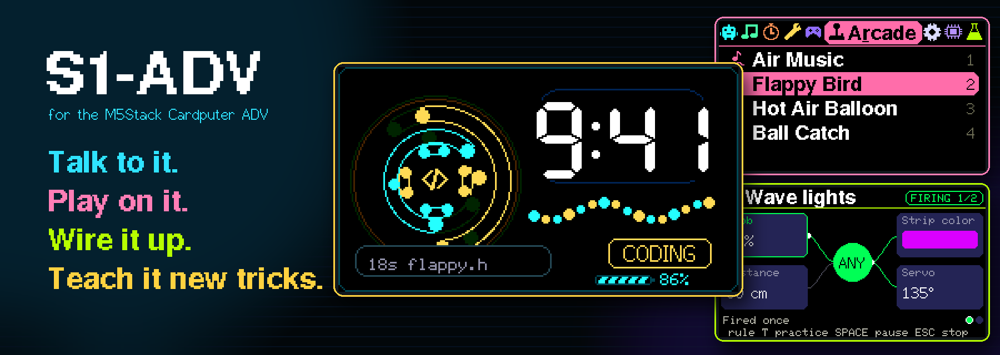
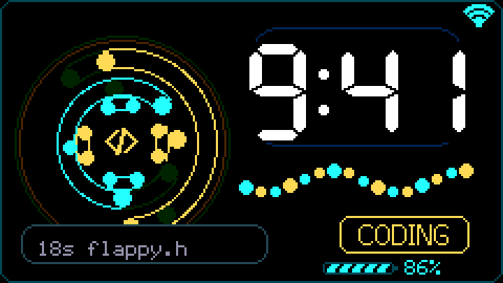
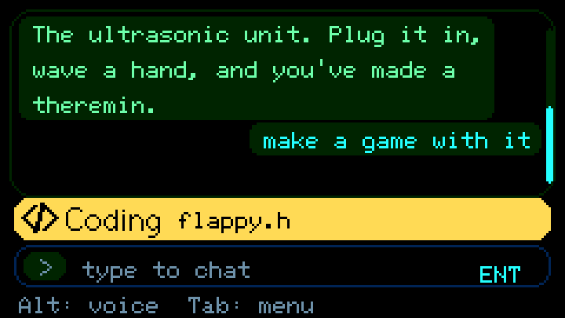
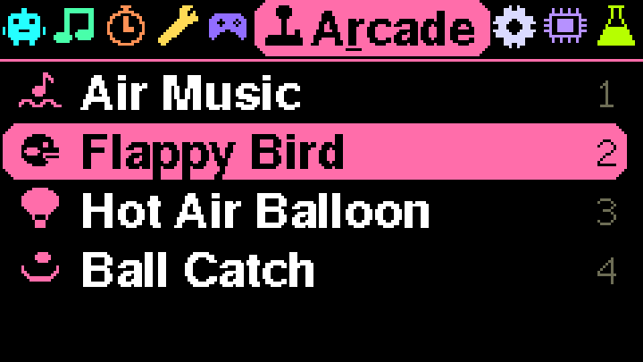
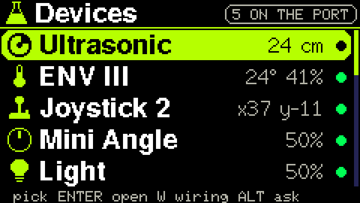
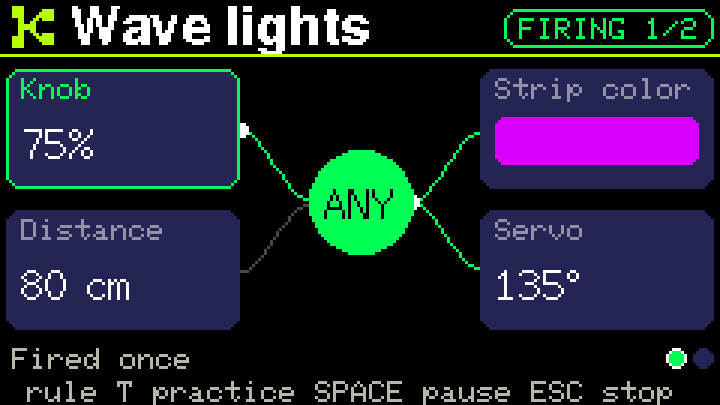
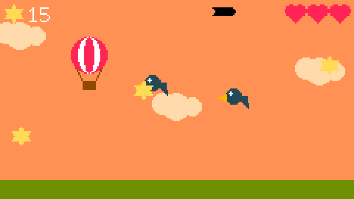

<p align="center"></p>

<p align="center">


<a href="#credits-and-license"></a>
</p>

# S1-ADV

**A pocket computer you can talk to, play on, wire up and teach new tricks.**

S1-ADV is free, open-source firmware for the [M5Stack Cardputer ADV](https://docs.m5stack.com/en/products/sku/K132-Adv), a credit-card-sized computer that costs about $30 and already has a keyboard, color screen, speaker, microphone, battery and Wi-Fi.

Put S1-ADV on it and you get a menu of more than 40 apps: an AI assistant that runs on your own Claude subscription, games you play by waving your hand, a lab for testing sensors and joining them with rules, and everyday tools that need no account at all.

**Never flashed a device or plugged in a sensor? This page is for you.** There's no soldering, you don't need to code to start, and if anything goes wrong, a USB cable brings it back.

[See it](#see-it) · [New to this?](#new-to-this) · [What to buy](#what-to-buy) · [Set it up](#set-it-up) · [Things to try](#things-to-try) · [Good to know](#good-to-know) · [Help](#if-something-goes-wrong)

## See it

<table>
<tr>
<td width="33%"><br><sub><b>Pulse.</b> The clock, plus what Claude is doing right now.</sub></td>
<td width="33%"><br><sub><b>AI Chat.</b> Type or talk. Every kind of work has its own color and sound.</sub></td>
<td width="33%"><br><sub><b>App menu.</b> Nine tabs, one letter key each.</sub></td>
</tr>
<tr>
<td><br><sub><b>Lab: Devices.</b> Plug a part in and see it respond.</sub></td>
<td><br><sub><b>Lab: Rules.</b> "If this, then that" with real parts, no code.</sub></td>
<td><br><sub><b>Hot Air Balloon.</b> Blow on a sensor to rise. Yes, really.</sub></td>
</tr>
</table>

<sub>These are real screens: the firmware's own drawing code, run on a computer with sample data. They're shown three times their actual size.</sub>

## What it does

**Talk to Claude from your pocket.** Type a question, or tap Alt and speak. The answer appears on screen and can be read aloud. It remembers your conversation across restarts, and you can tell it to remember things for good.

**Watch it work.** While Claude thinks, the screen and speaker show what it's up to: searching, reading, coding, building, testing. Each one has its own color, icon and sound.

**Ask it to build things.** Point it at this code, say "add a snake game and send it to me", and Claude edits the firmware, builds it and offers it to your Cardputer over Wi-Fi. You review it and press install.

**Play.** Tetris, Chess, Checkers, Minesweeper, Snake, and an NES emulator for your own game files. Wave a hand over a sensor to fly Flappy Bird or play notes in the air.

**Connect the real world.** Plug in sensors, lights, motors and switches. The Lab tests each one, then joins them with rules you build step by step, or just say aloud: "when I wave my hand, turn the strip red." Line up timed steps as sequences, and let a rule start them. Then talk to it: change a rule by voice, ask why one didn't fire, or have rules speak. The [Lab guide](docs/LAB.md) shows how it all works.

**Use it every day.** Focus timer, alarms, calendar, notes, calculator, weather, Internet radio, a synth you play on the keyboard, an infrared remote for TCL and Daikin air conditioners.

<details>
<summary><b>Every app, by menu tab</b></summary>

| Tab | Key | Apps |
| --- | --- | --- |
| AI Agent | A | Realtime, Pulse, AI Chat |
| Media | M | Library, Folders, Voice Notes, Notes, Assets, Files, Internet Radio, VLC Remote |
| Focus | F | Pomodoro, Alarm, Stopwatch, Calendar, Chess Mind, Chess, BrainFlow, KeyRush |
| Tools | T | Calculator, NFC Notes, RFID Lab, IR Remote, smartLamp, Sonar, Mesh, Pocket Synth |
| Games | G | Tetris, NES, Checkers, Minesweeper, Snake |
| Arcade | R | Air Music, Flappy Bird, Hot Air Balloon, Ball Catch |
| Settings | S | Device, Display, Wi-Fi, Pomodoro |
| System | Y | Firmware, Logs, C-Matrix |
| Lab | L | Devices, Rules, Sequences |

</details>

## New to this?

Here's the whole hobby in a minute.

A **microcontroller** is a small, cheap computer that runs one program and nothing else. There's no Windows and no app store. That one program is called **firmware**, and copying it onto the device is called **flashing**. Flash different firmware and the same hardware becomes a different machine. That's the fun of it, and it's why you can't really break anything: you can always flash again.

Most people start with a bare circuit board, a bag of wires and a lot of troubleshooting. The Cardputer skips all of that. The screen, keyboard, battery, speaker and microphone are already in the case, and add-on parts connect with one plug-in cable.

S1-ADV gives you a working device on day one. Then you go as deep as you like: play with it, add a sensor, build rules, change a line of code, or let Claude change it for you.

<details>
<summary><b>Words you'll run into</b></summary>

| Word | What it means |
| --- | --- |
| **Firmware** | The program that runs on the device |
| **Flash** | Copy firmware onto the device, usually over USB |
| **OTA** | "Over the air": a firmware update sent over Wi-Fi |
| **ESP32-S3** | The chip inside the Cardputer |
| **Bridge** | A small program from this repository that runs on your computer and carries messages between the Cardputer and Claude |
| **Device token** | A long password that proves to your bridge that this is your Cardputer |
| **Grove** | M5Stack's four-wire plug for add-on parts: power, ground and two signal wires |
| **I²C** | How several sensors share those two signal wires, each with its own address |
| **Hub** | A splitter that lets more parts share the one Grove port |
| **LoRa** | A long-range, low-power radio for short messages, with no internet involved |
| **Meshtastic** | A community project that passes LoRa text messages from radio to radio |
| **2.4 GHz** | The only Wi-Fi band this chip can use. A router's 5 GHz network won't appear |

</details>

## What to buy

**To start, you need one thing: a Cardputer ADV.** Prices below are rough, so check before you order.

| Item | About | Notes |
| --- | --- | --- |
| [M5Stack Cardputer ADV](https://docs.m5stack.com/en/products/sku/K132-Adv) | $30 | Sold by M5Stack and many electronics shops, as model K132-Adv. Buy the **ADV**: S1-ADV targets it and its 8 MB of flash, and the original Cardputer is untested |
| USB-C data cable | You may own one | Some cables only charge, and those can't flash. If your computer doesn't see the device, try another cable first |
| microSD card | $5 to $10 | Optional at first. Saved Wi-Fi networks, voice notes, audio, NES games and Lab rules live on it |

**For the AI features**, you also need a Claude subscription and a Mac or Linux computer that stays on. Games, tools, Internet Radio and the Lab work without them.

**Then add parts as you get curious.** Most Grove units cost $7 to $10, and the games below also play on the keyboard, so none of these are required.

| Part | What it unlocks |
| --- | --- |
| **Ultrasonic unit** (Unit Sonic I2C, RCWL-9620) | Air Music, hand-flown Flappy Bird, Sonar, distance rules. **The best first buy** |
| **ENV III** | Blowing on the sensor in Hot Air Balloon, temperature and humidity rules |
| **Joystick 2** | Steering in Hot Air Balloon and Ball Catch |
| **NFC Universal unit** (ST25R3916) | NFC Notes: read tags and save notes on them |
| **1-to-3 hub** | Two or more parts on the one Grove port |
| **I/O hub** (Unit PbHub) | Runs a Mini Angle, Light, PIR, relays, a servo and an LED strip all at once. One at a time, they plug straight into the Grove port. [Which setup do I need?](docs/LAB.md#pick-a-setup) |
| **Cap LoRa-1262** (about $15) | Mesh text, a private channel and direct messages, Help with your location when your phone can't, a radio scanner and GPS. Read the [Mesh note](#good-to-know) first. M5Stack also sells it with the Cardputer as a Mesh Kit |
| **Grove IR receiver** | Teaching the IR Remote new buttons. Sending needs nothing extra |

RFID Lab (an RC522 reader) uses a part wired to the EXT header instead of the Grove port, and it can't share that header with the Cap. Sonar works with the Ultrasonic unit on Grove or with an HC-SR04 wired to the EXT header, and finds whichever is plugged in. Mesh keeps it closed either way, because of the HC-SR04's pins.

## Set it up

Steps 1 and 2 give you a working Cardputer. Steps 3 and 4 add Claude and your voice, and you can come back to them any time.

### 1. Put the firmware on

You need Git and Python 3 on your computer. Plug in the Cardputer, turn it on, then run:

```bash
git clone https://github.com/softroni/s1-adv.git
cd s1-adv
python3 -m venv .venv
source .venv/bin/activate
pip install platformio==6.1.19
python scripts/cardputer.py build
python scripts/cardputer.py upload
```

The first build downloads about 3 GB of tools, so give it a while. On Windows, activate with `.venv\Scripts\Activate.ps1` instead.

**If the upload can't connect:** hold the **G0** button, press **Reset**, release G0, and run the upload again. `python scripts/cardputer.py ports` lists your ports, and `upload --port YOUR_PORT` picks one.

**When it finishes, unplug the Cardputer and plug it back in.** It can sit in flashing mode with a blank screen until you do.

<details>
<summary><b>Prefer not to build anything?</b></summary>

On macOS or Linux, `./scripts/flash-cardputer.sh` flashes a ready-made public image with one command, and it needs only Python 3. It's quick, but that image is **0.2.201**, so it has no Lab, no Arcade and none of the newer features on this page. Use the setup page in [step 3](#3-connect-claude) to get it online, and build from source when you want everything. See [Build and flash](docs/FLASHING.md).

</details>

### 2. Get it on Wi-Fi

The Cardputer starts on a setup screen. Press **Enter**, pick your 2.4 GHz network, type the password and press Enter. It restarts once it has joined.

Press **Tab** and you're in. Games, tools, Internet Radio and the Lab all work from here with no account and no bridge. If that's all you want, you're done.

### 3. Connect Claude

You'll need [Node.js 22+](https://nodejs.org), [FFmpeg](https://ffmpeg.org) and [Claude Code](https://code.claude.com/docs) signed in to your subscription. Check with `claude auth status`.

The Cardputer talks to the bridge over HTTPS, so the bridge needs a public address. [Tailscale](https://tailscale.com) Funnel is the shortest route. It puts the bridge on the internet, protected by your device token. It also takes over the port it uses, so run `tailscale serve status` first to check nothing else is on it. Port 443 is the default, and [the Funnel notes](docs/CLAUDE-CODE.md#tailscale-funnel) cover what to do if it's taken.

Run these one at a time. Funnel prints your public address, which goes in the `init` line, and it can take a few minutes to start working.

```bash
cd bridge
npm ci
tailscale funnel --bg 31889
node scripts/setup.mjs init --public-url https://YOUR-MACHINE.YOUR-TAILNET.ts.net --apply
CARDPUTER_BRIDGE_CONFIG=~/.s1-adv/config.json npm start
```

Leave the bridge running, and print your device token in a second terminal:

```bash
python3 -c "import json,os;print(json.load(open(os.path.expanduser('~/.s1-adv/config.json')))['devices'][0]['device_token'])"
```

Then finish on the Cardputer:

1. Type `/setup` in AI Chat and press Enter. The screen shows a Wi-Fi name and password.
2. **Join that Wi-Fi** from your phone or laptop. The setup page only exists on the Cardputer's own network.
3. Open `http://192.168.4.1/`.
4. Fill in **every field**: your Wi-Fi name and password again, your bridge address and your device token. Then save.
5. Switch your computer back to your normal Wi-Fi.
6. On the Cardputer, type `Reply with: ready` in AI Chat and press Enter.

**Seeing that reply on the Cardputer is the real test.** The computer has to stay on and awake while you use it, and replies count against your Claude plan limits.

Want a different address, or to run it after you close the terminal? See [Use your Claude subscription](docs/CLAUDE-CODE.md). Already run [OpenClaw](https://github.com/openclaw/openclaw)? The bridge works with that too: see the [OpenClaw guide](docs/OPENCLAW.md).

### 4. Add your voice

On a Mac:

```bash
brew install whisper-cpp espeak-ng ffmpeg
cd bridge
node scripts/setup.mjs voice --config ~/.s1-adv/config.json --apply
```

This downloads speech models of about 260 MB. Restart the bridge, tap **Alt** on the Cardputer, speak, and tap **Alt** to send. Your audio stays on your computer, and only the transcribed text goes to Claude. Linux steps are in [Add voice](docs/CLAUDE-CODE.md#add-voice).

## Things to try

First, the keys. On the Cardputer, the arrows are the `;` `.` `,` `/` keys, and Esc is the top-left key.

| Key | What it does |
| --- | --- |
| **Tab** | Open the app menu |
| **A letter** in the menu | Jump to a tab: **G** Games, **R** Arcade, **L** Lab and so on |
| **Enter** / **Esc** | Open / go back |
| **Alt** | Tap to talk, tap again to send |
| **G0 button** | Hold to talk, release to send |
| `/help` `/status` `/ota` | Type in chat for help, connection details and firmware updates |

Then work your way down this list. Each step needs a little more than the last.

1. **Play something.** Tab, G, Tetris. Then Tab, R, Flappy Bird, where Space flaps.
2. **Turn on the radio.** Tab, M, Internet Radio, then pick a genre.
3. **Say hello to Claude.** Open AI Chat, ask anything, then try it with your voice.
4. **Plug in a sensor.** Connect the ultrasonic unit, then Tab, L, Devices. Move your hand and watch the number change. Now open Air Music and play it like a theremin.
5. **Make your first rule.** Tab, L, Rules, then Recipes. Add **Air theremin** and press P to play it. When that works, try **+ New rule**, or **Say a rule** with Claude connected. The [Lab guide](docs/LAB.md) walks through every step.
6. **Change the code.** Open `bots/CardputerADV/src/flappy.h`, raise `kLargestGap` from 60 to 80, and run `python scripts/cardputer.py upload`. You've just made Flappy Bird easier, and that's real firmware development.
7. **Let Claude change it for you.** Give it [one project folder](docs/CLAUDE-CODE.md#let-claude-work-in-a-folder), turn on [firmware updates](docs/CLAUDE-CODE.md#update-firmware-from-the-cardputer), and ask from the Cardputer for the app you want. Read the risks in those guides first.

## How it works

```text
 Cardputer ADV   <--- HTTPS over Wi-Fi --->   Bridge on your computer   --->   Claude
 keyboard, mic, screen, speaker               Node.js, runs `claude`           your subscription
```

**No AI runs on the Cardputer.** It's the keyboard, screen, microphone and speaker. Each message goes to the bridge on your computer, which hands it to the `claude` program under your own login and sends the answer back.

**There's no shared server and no account with this project.** The bridge never reads or stores your Claude login, and it refuses to use anything else if that login is missing.

**By default Claude has no tools here.** It can chat, but it can't read your files, run commands or browse the web until you turn each of those on, and then the operating system's sandbox limits what it can reach. See [privacy and isolation](docs/CLAUDE-CODE.md#privacy-and-isolation).

Offline apps run entirely on the Cardputer.

## Good to know

S1-ADV is a fast-moving, experimental project. Some of it is set up for one owner's Cardputer, so here's what to expect.

- **The Lab is new and still being tuned on real parts.** Some fixes have only run against simulated ones, so a part may misbehave. The Light test has F to flip its reading, and the LED strip test has T to try other timing.
- **Grove power has limits.** M5Stack doesn't publish one for this port. A full-white 30-LED strip can draw 1 A and a stalled servo 750 mA, so keep the strip's limit low. If the Cardputer restarts, give the strip its own 5 V supply and join the grounds.
- **The clock is fixed to US Central time.** To change it, edit `kDeviceTz` in `bots/CardputerADV/src/main_parts/001_main.cpp.inc` and rebuild.
- **US units by default.** Settings, Device, Units switches the Lab, Sonar, GPS and weather to metric.
- **Weather comes through the bridge and covers US places only.** Set your city in Settings, Device, Weather city. With the Cap LoRa-1262 fitted and a GPS fix, Pulse shows the weather where you are instead, anywhere. See [Weather on Pulse](docs/CONTROLS.md#weather-on-pulse).
- **Mesh uses Meshtastic's US region, 906.875 MHz, unless you pick another.** Set yours in Settings, Device, Mesh region before you send anything, because a radio on the wrong region hears no one and may not be legal where you are. [Mesh](docs/MESH.md#region) lists the regions. Always fit the antenna before powering the Cap.
- **NES games aren't included**, apart from a free homebrew sample in `third_party/honkeypong/bin`. Only mappers 0 and 4 work, and some games run below full speed. See [NES games](docs/NES.md).
- **Realtime voice is a separate, experimental mode.** It's off by default and needs its own provider setup.
- **Your device token is a password.** Anyone who has it can chat as you and use up your plan. Never commit `.env`, `~/.s1-adv/` or a firmware image built with your settings. Read [SECURITY.md](SECURITY.md).
- **Run your own bridge, for yourself.** Don't host one for other people on your subscription. See [Terms and plan limits](docs/CLAUDE-CODE.md#terms-and-plan-limits).
- **Some guides are still in Russian**, including Pocket Synth, VLC Remote and Chess Mind. The device itself defaults to English, and Russian typing works too.

## If something goes wrong

| What you see | What to try |
| --- | --- |
| Your computer doesn't see the Cardputer | Check its power switch, then try another cable. Charge-only cables don't work |
| Upload can't connect | Hold G0, press Reset, release G0, then upload again |
| Blank or frozen screen after flashing | It's still in flashing mode. Unplug it and plug it back in |
| `192.168.4.1` shows your router or a `blocked.eero.com` page | You're not on the Cardputer's Wi-Fi yet. If you are, unplug any Ethernet cable for a moment or use a phone |
| Your Wi-Fi isn't listed | It's probably 5 GHz. The Cardputer only sees 2.4 GHz |
| Wi-Fi stopped working after using the setup page | Leaving its password box blank wipes the saved password. Press Enter on the setup screen and join your network again |
| `Claude Code is not signed in...` | Run `claude auth login` on the bridge computer |
| Text works but voice doesn't | Run `node scripts/setup.mjs doctor --config ~/.s1-adv/config.json --no-probe` in `bridge/` to see what's missing |

Type `/status` on the device to see its connection and version. There's much more in [Troubleshooting](docs/TROUBLESHOOTING.md).

## Go deeper

| Guide | What's in it |
| --- | --- |
| [The Lab](docs/LAB.md) | A picture guide to connecting parts, testing them, building rules and sequences, and talking to the Lab |
| [Everyday controls](docs/CONTROLS.md) | Every key, every status sound, and the Lab in full |
| [Use your Claude subscription](docs/CLAUDE-CODE.md) | The bridge, memory, voice, web access and firmware updates |
| [Voice tools](docs/VOICE-TOOLS.md) | Give any screen the chat's recorder, for your words or Claude's answer |
| [Build and flash](docs/FLASHING.md) | Every way to flash, plus building with your own settings |
| [Mesh](docs/MESH.md) · [NES](docs/NES.md) · [Focus audio](docs/FOCUS-AUDIO.md) | The optional extras |
| [OpenClaw](docs/OPENCLAW.md) | Using the bridge with your own OpenClaw agent |
| [Architecture](docs/ARCHITECTURE.md) | How the firmware and bridge fit together |
| [Security](SECURITY.md) | What to keep private, and the trust model |

## Inside the repository

| Folder | What's there |
| --- | --- |
| `bots/CardputerADV/` | The firmware: C++ on Arduino and FreeRTOS, built with PlatformIO |
| `bots/CardputerADV/src/*.h` | Most games and tools keep their rules here, away from the hardware, so they're a good place to start reading |
| `bridge/` | The Node.js bridge and its tests |
| `scripts/` | Build and flash tools, plus host tests that run the real game and screen code on your computer |
| `docs/` | Guides and release notes |

Changes are welcome. [CONTRIBUTING.md](CONTRIBUTING.md) lists the checks to run:

```bash
cd bridge
npm ci
npm run test:security
npm run smoke
```

## Credits and license

S1-ADV comes from [s1z0v/s1-adv](https://github.com/s1z0v/s1-adv) by Sergey Sizov, which grew out of [OmniBot](https://github.com/nazirlouis/OmniBot) by Naz Louis and its contributors. It's built on [M5Stack's libraries](https://github.com/m5stack/M5Cardputer), [Meshtastic](https://meshtastic.org) leaf code, Nofrendo and more. [CREDITS.md](CREDITS.md) has the full list.

The source is under the [MIT license](LICENSE). The firmware image links [libmeshtastic-leaf](https://github.com/Meshtastic-Solutions/libmeshtastic-leaf), so it's distributed under GPL-3.0-only, and other dependencies keep their own licenses. See [Mesh licensing](docs/MESH.md#source-and-licensing).

This is an independent hobby project, not affiliated with M5Stack or Anthropic.
