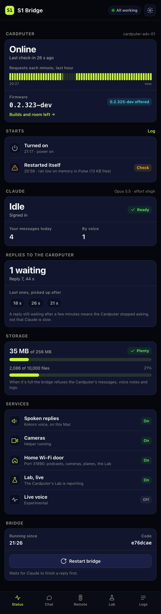
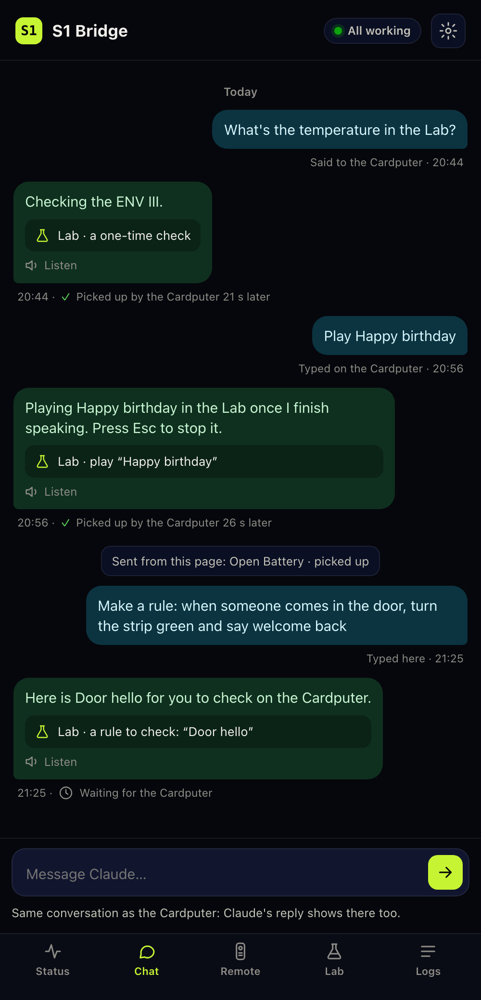
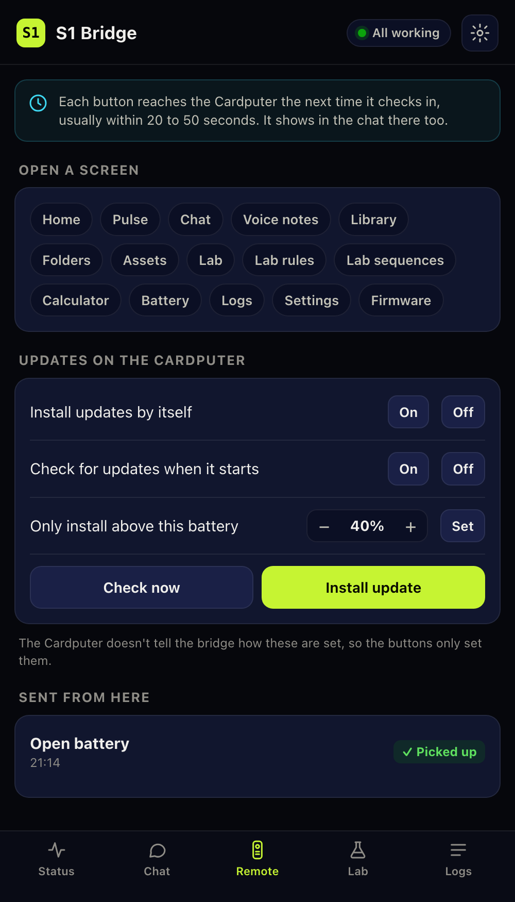
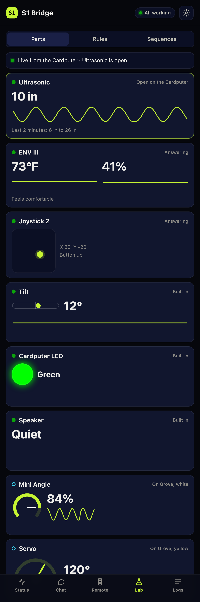
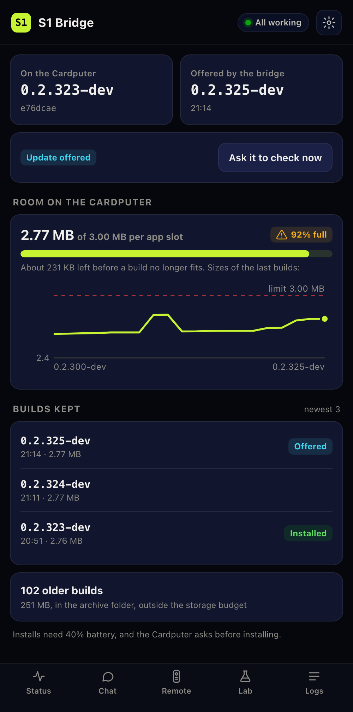
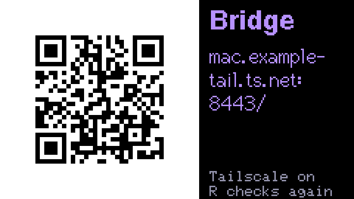
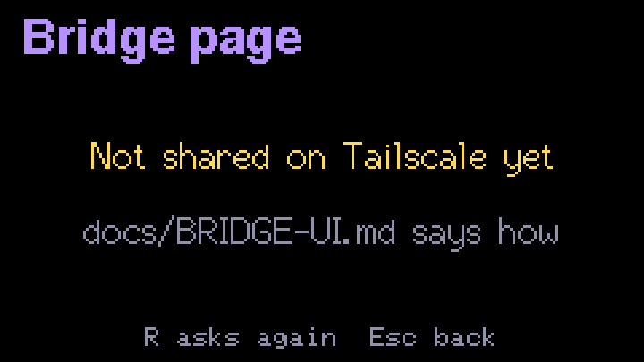

# The bridge's web page

The bridge has its own web page: the Cardputer's status, the chat, a remote, the Lab live, Radio, the log, firmware and settings. It runs on the computer that runs the bridge, and you open it on your phone or another computer.

<table>
<tr>
<td width="20%"><br><sub><b>Status.</b> Is everything working?</sub></td>
<td width="20%"><br><sub><b>Chat.</b> The Cardputer's conversation.</sub></td>
<td width="20%"><br><sub><b>Remote.</b> Run the Cardputer from here.</sub></td>
<td width="20%"><br><sub><b>Lab.</b> Every part, live, and controls.</sub></td>
<td width="20%"><br><sub><b>Firmware.</b> What's installed, and room left.</sub></td>
</tr>
</table>

## Turn it on

Add a `ui` block to the bridge's `config.json` and restart the bridge:

```json
"ui": {
  "enabled": true,
  "port": 31891,
  "allowRestart": true,
  "logFile": "/Users/me/.s1-adv/bridge.log"
}
```

- `enabled` starts the page. It's off unless you turn it on.
- `port` is where it listens, on `127.0.0.1` only, so nothing else on your network can reach it directly.
- `allowRestart` lets the page restart the bridge: its Restart button and saving Settings. Leave it off when OpenClaw runs the bridge, because OpenClaw starts and stops it.
- `url` is the address a phone opens, if you share the page some other way than `tailscale serve`. The Cardputer's Bridge page shows it.
- `logFile` is where the bridge's output goes, if you send it to a file. The Logs screen then shows lines from before the last restart too. Without it, Logs shows this run's lines only.

With the page on, every line the bridge writes starts with the date and time.

## Open it on your phone

The page only listens on the computer itself. To reach it from your phone, share it inside your own private network. With [Tailscale](https://tailscale.com), on the bridge's computer:

```bash
tailscale serve --bg --https=8443 http://127.0.0.1:31891
```

Then open `https://<your computer's Tailscale name>:8443/` on any device signed in to your tailnet. On a phone, Add to Home Screen makes it an app icon.

### Forgot the address?

On the Cardputer, open **System**, then **Bridge page**. It asks the bridge where its page is each time it opens, and shows a QR code to scan with your phone, with the address beside it to type.

<table>
<tr>
<td width="50%"><br><sub><b>Bridge page.</b> Scan it, or type the address. R asks again.</sub></td>
<td width="50%"><br><sub><b>Nothing to show yet.</b> The bridge says why.</sub></td>
</tr>
</table>

The bridge finds the address in Tailscale's own settings: the `tailscale serve` site that points at the page's port. If you share the page some other way, put its address in `ui.url` in `config.json` and the Cardputer shows that instead. The address never goes into the firmware.

- **Not shared on Tailscale yet:** run the `tailscale serve` line above.
- **The page is off on the bridge:** set `ui.enabled` to true and restart the bridge.
- **It's on Funnel: take it off:** the site that serves the page is public, so the Cardputer won't show it. Turn Funnel off for that port.
- **Tailscale isn't running:** start Tailscale on the bridge's computer.
- **The bridge didn't say:** the bridge is older than its page. Update it.

Needs firmware 0.2.328 or later.

Never put the page on Tailscale Funnel or any public address: it can send messages to Claude and change the bridge's settings. The page only answers requests addressed to `localhost`, `127.0.0.1` or a `.ts.net` name. For another private name, list it in `ui.allowedHosts`.

## Status

Whether everything works, at a glance. The pill at the top of every screen turns amber when something needs you.

- **Cardputer:** online or not, when it last checked in, and a strip of the last hour with each minute it reached the bridge. A gap is a time it was off or out of reach. Below it, the firmware it says it runs, and whether a newer one is offered.
- **Starts:** each time the Cardputer started since the bridge did, and why: turned on, restarted itself, or crashed. When it restarted itself for lack of memory, it says on which screen.
- **Claude:** idle or working, and on what, as the Cardputer's chat shows it. It says if Claude needs you to sign in again on the computer.
- **Replies to the Cardputer:** replies the Cardputer hasn't collected yet, and how long the last ones took. A reply still waiting after a few minutes means the Cardputer stopped asking, not that Claude is slow.
- **Storage:** how much of its storage budget the bridge uses, in space and in files. When it's full, the bridge refuses the Cardputer's messages, voice notes and logs, so it turns amber at 60% and red at 80%.
- **Services:** spoken replies, cameras, the home Wi-Fi door, the Lab's live readings and live voice.
- **Bridge:** when it started, which commit it runs, and a Restart button. The bridge waits for Claude to finish a reply before restarting.

## Chat

The Cardputer's own conversation, with everything said by typing or by voice.

- **Claude's actions show as actions,** like "Lab · play Happy birthday", instead of the code the Cardputer reads.
- **Each reply says when the Cardputer picked it up,** or that it's still waiting.
- **Listen** reads a reply aloud in the spoken replies' voice.
- **Type to Claude here.** It's the same conversation, so Claude's reply shows on the Cardputer too, and Claude can send it actions, like a Lab rule to check, as if you'd typed on it.

## Remote

Buttons that ask the Cardputer to do something: open a screen, turn its automatic updates or start-up checks on or off, set the battery it needs to install, check for an update, or install it.

- **They arrive when it next checks in,** usually within 20 to 50 seconds, and show in the Cardputer's chat as a short message. Sent from here lists them, and whether each has arrived.
- **The Cardputer doesn't report its settings to the bridge,** so the update buttons set them but can't show how they're set now.

## Lab

Three tabs: Parts, Rules and Sequences.

**Parts** draws every part the Lab knows, live, while the Lab is open on the Cardputer at home: distance with a graph of the last two minutes, temperature and humidity, the joystick's position, the knob's dial, light, motion, the relays, the servo's angle, the LED strip's colors, the I/O hub's ports, the GPS, tilt, the Cardputer's LED and speaker, the smartLamp and the air conditioners. The part open on the Cardputer comes first, then those that are there. A dot says what the Lab knows, as on its Devices list: solid is there, a ring is set up but can't confirm it, grey isn't found. The bar at the top says whether it's live and what the Cardputer shows, and which rules are firing.

The readings only come over your home Wi-Fi, and only while the Lab is open. See [the Lab guide](LAB.md#on-the-bridges-page) for what the Cardputer sends and when.

**Controls** sit under each part that can be driven, and act within about a second, while the Lab is open on the Cardputer at home:

| Part | Controls |
| --- | --- |
| Servo | An angle slider, and 0°, Center and 180° |
| LED strip | Eight colors and Off, brightness and how many LEDs |
| Cardputer LED | Eight colors and Off |
| Speaker | A pitch, and Beep |
| 2 relays | Turn each on or off |
| smartLamp | On, Off and brightness |
| IR for AC | TCL on or off, Daikin on or off |

- **The relays, the lamp and the air conditioners switch the moment you tap,** with no question on the page or the Cardputer. Those can switch mains power, so mind what's plugged in.
- **Each card says what became of your last tap:** sent, done, or not done and why, such as a sequence holding that part.
- **Some taps are refused:** anything while rules play, since they decide every part, and a servo, strip or relays the Lab hasn't been told about in Devices, unless that part's screen is open on the Cardputer.
- **A tap the Cardputer hasn't collected within 5 seconds is dropped,** so nothing happens later on its own.
- **What you set lasts until the Lab takes it back,** as a test screen's does: a rule or a sequence taking the part, its screen closing, or the Lab closing, when everything goes back to rest, relays and lamp off included.
- **Away from home, or with the Lab closed,** the controls are greyed out.

Controls need firmware 0.2.330 or later.

**Rules** and **Sequences** show what's saved on the Cardputer, as it last told the bridge with a chat message. Play starts a sequence, and New rule builds one with menus, in the units you read. Like everything Claude sends, a rule from here waits on the Cardputer until you check it there.

## Radio

Which frequency the planes around you are probably on, for listening on an ordinary air-band radio (118–137 MHz, AM). Nothing says which frequency a plane is tuned to, so the page guesses from what each one is doing.

**Where:** the position Skywatch last asked about on the Cardputer (its GPS, or the city saved in Settings), used for 12 hours. "Use a town" types one instead. Either is kept only in the bridge's memory and never saved.

**By frequency** is for listening:

- **Pick the frequency your radio is on.** The list is in groups (your area's approach frequencies, towers within 25 miles, Center within 80), each in number order, with how many planes within your range the page guesses on each. **Something else** takes any frequency.
- **The planes come as a grid of call signs,** the airline's logo and spoken name over the flight number, so "Southwest 1317" is *Southwest* over **1317**. Green ★ is the page's guess for that frequency, amber its second choice. The rest show with **Every plane**.
- **The grid keeps its order:** guesses first, then second choices, then the rest, each by airline and number. A new plane joins the end of its group, outlined for 30 seconds. One that leaves your range or the radio's reach fades where it is.
- **Range** is 5, 10, 25 or 50 miles. Pilots carry far, so a plane 40 miles away may be the one you hear.
- **Tap a tile** for its details at the bottom: height, climbing or descending, distance, and its guess. **I heard it on** saves that you heard it there. One that isn't listed can be typed in.

**Near me** lists the planes within 8 miles with their guess, and **Listen on** opens that frequency with the plane picked.

**How it guesses:**

- **Low beside a towered airport:** that tower. An airliner gets only the area's big airports.
- **Code 1200:** a small plane flying on its own, not talking to anyone.
- **Climbing out of a big airport,** or up 1,500 ft in the last few minutes though level for now: its departure frequency for the direction it's going.
- **Coming down to one:** its arrival frequency for that side, then the final's as it lines up.
- **Below 10,000 ft with a code a controller gave it:** the local approach sector.
- **Cruising or anything else:** the two nearest Center radio sites for its height.

Towers and Center come from the FAA's free frequency list, which the bridge downloads every 28 days. How an approach control divides its frequencies isn't in it in a usable form, so that part comes from an **area file** you keep at `<stateDir>/radio/area.json` (`~/.s1-adv/data/radio/area.json` by default). It never goes in the repo, because it says where you live. Without it the page uses towers and Center only. It looks like this, with the frequencies from the FAA list or your airport's chart supplement:

```json
{
  "approachName": "Test Approach",
  "airports": [
    { "code": "HUB", "name": "Hub", "lat": 40.0, "lon": -100.0,
      "departures": { "N": "121.1", "E": "121.2", "S": "121.3", "W": "121.4" },
      "arrivalSplit": "EW", "arrivals": { "E": ["122.1", "122.2"], "W": ["122.3", "122.4"] },
      "finals": { "E": "123.1", "W": "123.2" },
      "towerSplit": "EW", "towers": { "E": ["124.1", "124.2"], "W": ["124.6"] } },
    { "code": "CTY", "name": "City", "lat": 40.0, "lon": -99.67, "airlines": ["SWX"],
      "departures": { "E": "121.2", "S": "121.3" },
      "arrivalSplit": "NS", "arrivals": { "N": ["125.1", "125.2"], "S": ["125.2", "125.1"] },
      "towers": { "*": ["126.1"] } }
  ],
  "local": { "split": "NS", "lat": 40.0, "N": ["127.1", "127.2"], "S": ["127.2", "127.1"] },
  "catalog": [["Departures", [["121.2", "East"], ["121.1", "North"]]]]
}
```

- **The first airport is the hub:** an airliner coming down nearby, not pointed at any airport yet, is taken to be landing there.
- **`airlines`** names prefixes that fly from that airport rather than the hub.
- **Two frequencies** in a list are the first and second choice.
- **A side** (`EW` or `NS`) is which half of the airport the plane is on.
- **`catalog`** adds groups to the top of the frequency list.

The bridge reads the file when it starts.

What you save goes to `<stateDir>/radio/heard.jsonl`: the plane, its height, the guess and the frequency you heard it on, never where you are.

## Logs

The bridge's own log, newest first.

- **Filter by kind:** Cardputer, chat, voice, cameras, podcasts, firmware and more, or Problems for warnings and failures. Search finds any text.
- **The 20-second update checks are hidden,** because they're most of the log. The switch shows them again.
- **Logs the Cardputer sent,** with `/sendlogs` in its chat, are below.

## Firmware

The version on the Cardputer next to the one the bridge offers, and a button that asks the Cardputer to check now.

**Room on the Cardputer** is how much of its 3 MB app slot the offered build fills, with the sizes of recent builds, so you can see a build coming close to not fitting. Below, the builds the bridge keeps, and how many older ones are in the archive folder.

## Settings

Claude's model and effort, whether it can search the web and change the firmware, the spoken replies' voice and speed, the bridge's storage budget and how many firmware builds it keeps. Saving writes only these to `config.json` and, with `allowRestart`, restarts the bridge. The Cameras sign-in link is here too.

## Good to know

- **Nothing on the page changes the Cardputer directly.** Everything goes as a message it collects, as Claude's replies do.
- **Requests that change something need the page itself.** They carry a header a browser only sends from the page, so another site open in the same browser can't send them.
- **After a bridge restart,** the check-in strip and the starts list begin empty and fill as the Cardputer checks in.
