# The Lab

**Plug in a part, watch it respond, then make parts work together. No code.**

The Lab turns your Cardputer into a test bench. **Devices** shows everything it can reach, live, and most parts have extra pages with graphs, games and tools. **Rules** joins sensors to lights, motors and switches with "if this, then that", built one question at a time on the little screen. **Sequences** are steps that run in order, with waits between them.

With Claude connected, you can also [talk to it](#talk-to-it): say a rule, change one, have it speak, or ask why it didn't fire. From the chat, it can [check something once](#check-something-once) without opening the Lab.

<table>
<tr>
<td width="33%">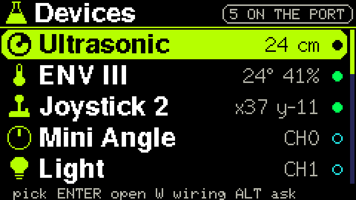 <b>1. Test a part.</b> See that it works before you build on it.</td>
<td width="33%">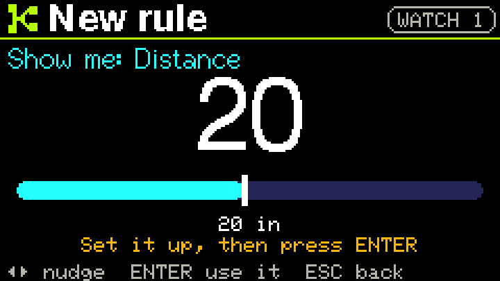 <b>2. Build a rule.</b> Answer a few questions, or show it with your hand.</td>
<td width="33%">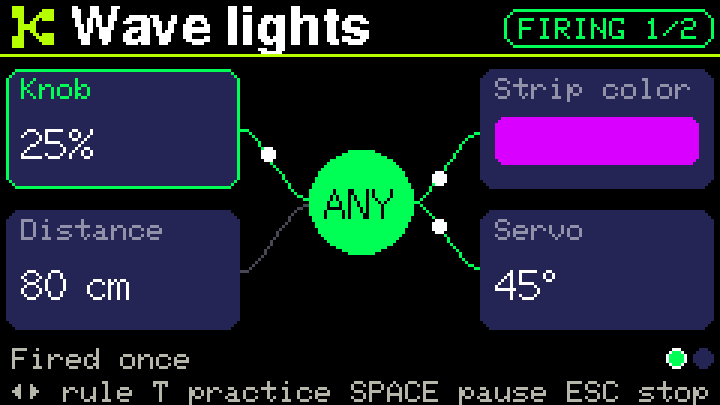 <b>3. Play it.</b> Watch the signal travel from sensor to output.</td>
</tr>
</table>

To open it, press **Tab**, then **L**. You can also type `/lab`, `/rules` or `/sequences` in chat.

On the Cardputer, the arrow keys are `;` up, `.` down, `,` left and `/` right, and Esc is the top-left key.

[Try it with no parts](#try-it-with-no-parts) · [Connect a part](#connect-a-part) · [Test a part](#test-a-part) · [Build a rule](#build-a-rule) · [Play it](#play-it) · [Sequences](#sequences) · [Talk to it](#talk-to-it) · [From the chat](#from-the-chat) · [Check something once](#check-something-once) · [On the bridge's page](#on-the-bridges-page) · [If a part doesn't answer](#if-a-part-doesnt-answer) · [Good to know](#good-to-know)

> The Lab needs firmware built from source, as in step 1 of the [README](../README.md#set-it-up). The older one-command flash doesn't have it.

## Try it with no parts

You don't need to buy anything to see how a rule works.

1. Press **Tab**, **L**, then open **Rules**.
2. **Wave lights** is already there. Press **P** to play it.
3. Press **T** to start Practice, then press up and down to fake the sensor.

The boxes turn green, the dots start moving, and the rule fires. Press Esc to end Practice.

More that needs nothing plugged in:

- **A sequence.** Open **Sequences**, pick **Hello** and press **P**. It plays on the Cardputer's own LED and speaker.
- **Tilt.** Open it in **Devices** and turn the page for a spirit level and a ball to roll into a hole.
- **Speaker.** Open it in **Devices** and turn the page for a piano.
- **Cardputer LED.** Open it in **Devices** and change its color.

## Connect a part

| Part | What it gives the Lab | How it connects |
| --- | --- | --- |
| Ultrasonic | Distance | I2C |
| ENV III | Temperature and humidity | I2C |
| Joystick 2 | Stick left-right, stick up-down, and its button | I2C |
| NFC Universal | A shortcut to NFC Notes | I2C |
| Mini Angle | A knob, from 0 to 100% | White wire |
| Light | Brightness, from 0 to 100% | White wire |
| PIR | Motion | White wire |
| Servo | An angle you can set | Yellow wire |
| LED strip | Color, brightness and how many LEDs are lit | Yellow wire |
| 2 relays | Two switches | Both wires |
| Cap LoRa-1262 | GPS position, speed, heading, altitude, distance from a saved spot, the satellites in the sky, and the radios Mesh heard | Fits on the Cardputer, not on Grove |

The Lab can also reach a smartLamp over Wi-Fi, and a TCL or Daikin air conditioner by infrared.

### Why the wire matters

The Grove port has two signal wires. **I2C** units share both and take turns, each with its own address. The simple parts need a wire to themselves. That's why the two kinds can't share the port, even through a hub: a Mini Angle on the same hub stops an I2C unit answering at all.

### Pick a setup

| What you want | What to plug in |
| --- | --- |
| One part | Straight into the Grove port. Any part works |
| A few I2C units | A 1-to-3 hub on the Grove port |
| One sensor driving one output, like a Mini Angle moving a servo | A 1-to-3 hub on the Grove port, with no I/O hub: one white-wire part and one yellow-wire part |
| Lots of simple parts | An I/O hub on the Grove port. Any part can go on any of its six ports |
| Simple parts and I2C units together | A 1-to-3 hub first, then the I/O hub in one socket and up to two I2C units in the others |

You can change your setup whenever you like, even with a part's screen open. The Lab notices the I/O hub or an I2C unit arriving or leaving, and the part follows. Rules work the same however the parts are connected.

<table>
<tr>
<td width="33%">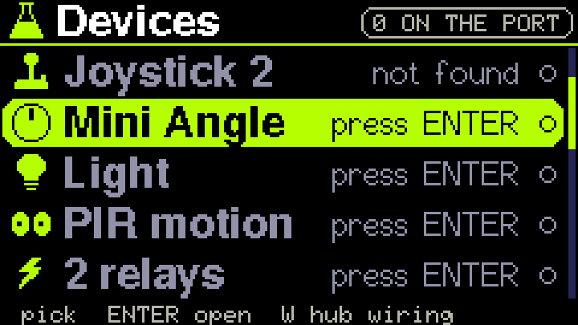 <b>Straight in.</b> Simple parts can't answer, so they say <i>press ENTER</i>. Opening one tells the Lab it's plugged in, and it remembers.</td>
<td width="33%">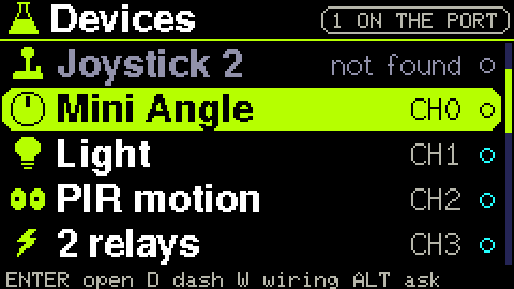 <b>On the I/O hub.</b> Each part shows its port until you open it.</td>
<td width="33%">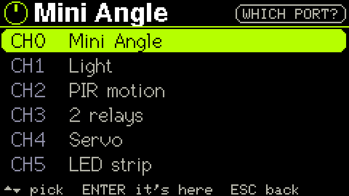 <b>Wrong port?</b> Open the part, press <b>P</b> and pick the port. It swaps with whatever was there.</td>
</tr>
</table>

To see all six ports at once, press **W** in Devices.

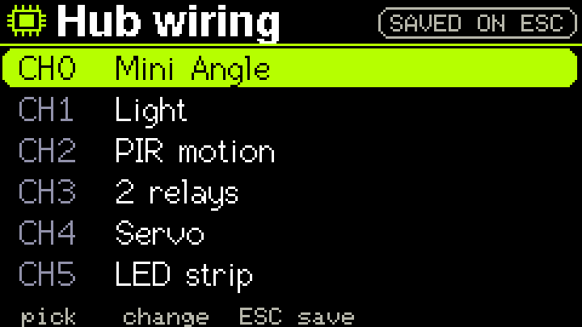

This is the starting layout. The I/O hub can't tell what's on a port, or whether anything is, so these need to match your cables. In this screen, up and down pick a port, and left and right change it.

## Test a part

Up and down pick a device, and Enter opens it. Esc goes back, and everything turns off when you leave a test screen.

The dot beside each device tells you what the Lab knows:

| Dot | Meaning |
| --- | --- |
| Solid | It's there |
| Cyan ring | It can be reached, but it can't confirm it's there. Outputs and I/O hub parts look like this |
| Grey ring | Not found yet. That's fine if you haven't plugged it in |

<table>
<tr>
<td width="33%">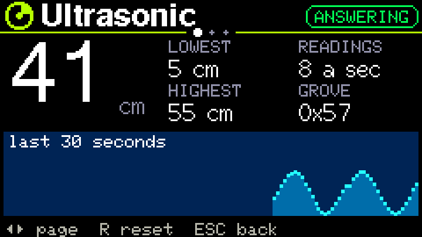 <b>Ultrasonic.</b> Live distance and the last 30 seconds. R resets the lowest and highest.</td>
<td width="33%">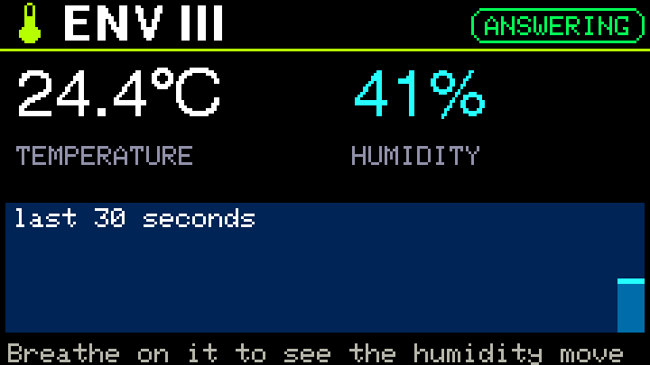 <b>ENV III.</b> Breathe on it and watch the humidity jump.</td>
<td width="33%">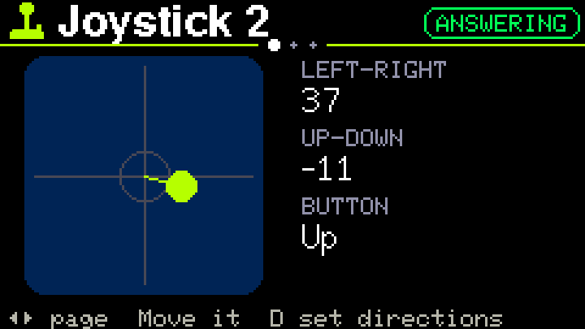 <b>Joystick 2.</b> The stick's position and its button. If the dot goes the wrong way, <b>D</b> sets its directions.</td>
</tr>
<tr>
<td>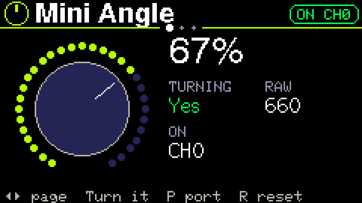 <b>Mini Angle.</b> Turn it end to end once so it learns its range.</td>
<td>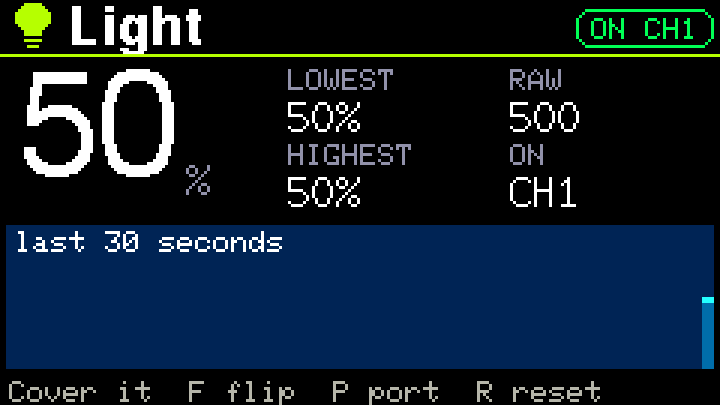 <b>Light.</b> Cover it to test it. If it reads backwards, F flips it.</td>
<td>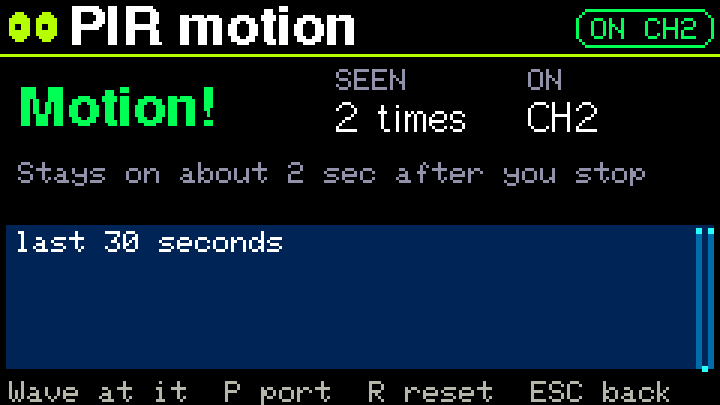 <b>PIR motion.</b> Wave at it. It stays on for about 2 seconds after you stop.</td>
</tr>
<tr>
<td>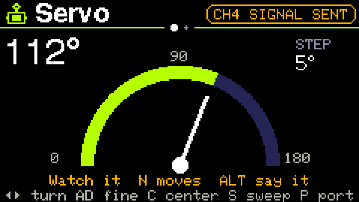 <b>Servo.</b> Left and right turn it 5°, A and D turn it 1°, C centers it and S sweeps it.</td>
<td>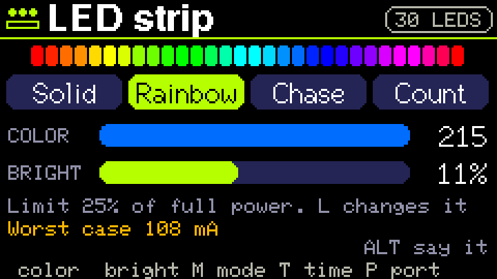 <b>LED strip.</b> M changes the pattern, L changes the power limit, and T tries other timing if it flickers.</td>
<td>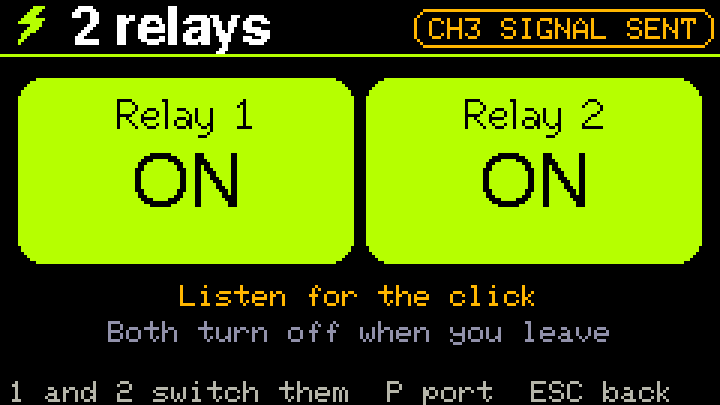 <b>2 relays.</b> Keys 1 and 2 switch them. Listen for the click.</td>
</tr>
<tr>
<td>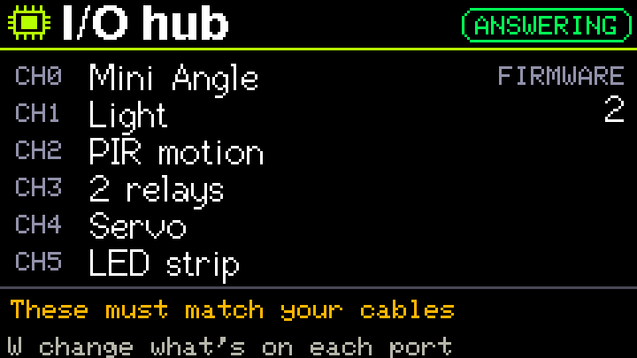 <b>I/O hub.</b> What's on each port, and its firmware.</td>
<td>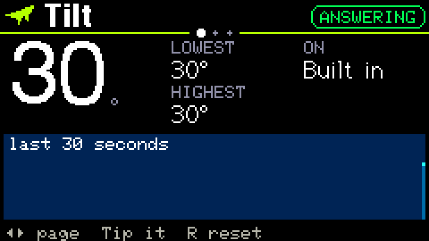 <b>Tilt.</b> Built in. Tip the Cardputer to see it move.</td>
<td>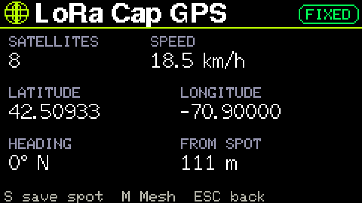 <b>LoRa Cap GPS.</b> A compass, speed, heading, which way and how far your spot is, satellites, altitude and position. S saves the spot, M opens Mesh. Two <a href="#the-gps-sky-and-mesh-pages">more pages</a> show the sky and the mesh.</td>
</tr>
<tr>
<td>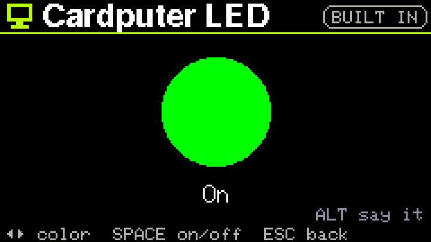 <b>Cardputer LED.</b> Built in. Left and right change the color, and Space turns it off or on. The screen goes to full brightness while it's lit.</td>
<td>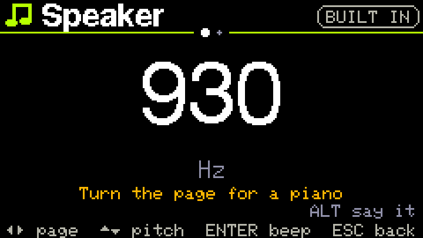 <b>Speaker.</b> Built in. Up and down change the pitch, and Enter beeps.</td>
<td>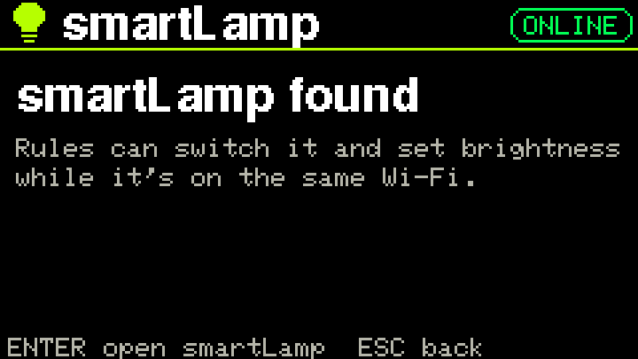 <b>smartLamp.</b> It looks for one on your Wi-Fi. Enter opens the smartLamp app.</td>
</tr>
<tr>
<td>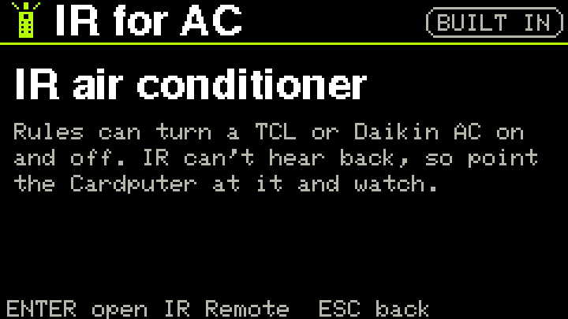 <b>IR for AC.</b> Rules can turn a TCL or Daikin air conditioner on and off. Enter opens IR Remote.</td>
<td>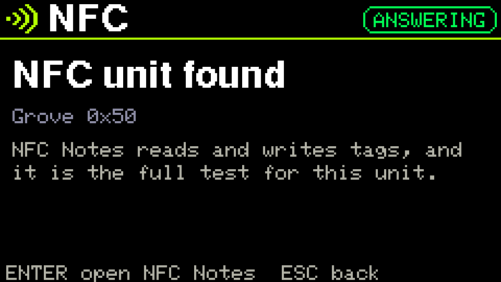 <b>NFC.</b> Enter opens NFC Notes, which is its full test.</td>
<td></td>
</tr>
</table>

The Cardputer LED takes its power from the screen light, and it only gets steady power with the screen at full brightness. So while a test, a rule, a sequence or the chat has it lit, the screen goes to full brightness, and it goes back to your own setting once the LED is off. When the screen turns itself off, the LED goes dark with it, and it comes back on when the screen wakes.

<table>
<tr>
<td width="33%">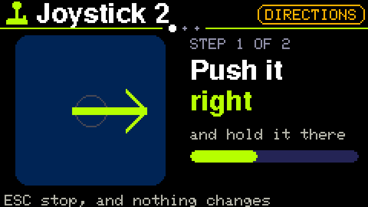 <b>Joystick 2: directions.</b> Push right and hold until the bar fills, then up.</td>
<td>The Joystick 2 reads differently depending on which way round you hold it, so the Lab can learn it. If the dot goes the wrong way, press <b>D</b> on its screen. Push the stick right and hold it until the bar fills, then push it up, away from you, and hold it again. It beeps after each push. The Lab saves this with the rest of its setup, and every page, rule and reading uses it from then on. Esc stops it part way and changes nothing.</td>
</tr>
</table>

The label at the top right tells you how much the Lab really knows. **ANSWERING** means the part replied just now. **ON CH0** or **ON GROVE** says where it is. **SIGNAL SENT** means a command went out, but an output can't reply, so watch the part itself.

### More pages

Most parts have more than one page. The dots under the title show where you are. Left and right turn the page, or **N** on the Servo, where the arrows already do something. **N** works on the others too.

<table>
<tr>
<td width="33%">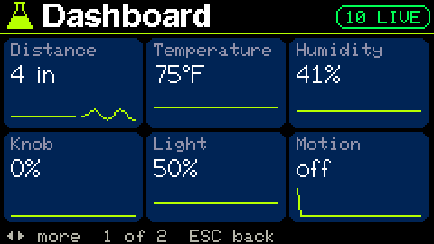 <b>Dashboard.</b> Press <b>D</b> on Devices to see everything live, with its last minute.</td>
<td width="33%">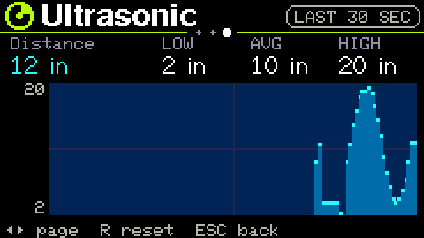 <b>Graph.</b> The last 30 seconds, scaled to what it saw, with low, average and high. On the ENV III, <b>T</b> swaps temperature and humidity.</td>
<td width="33%">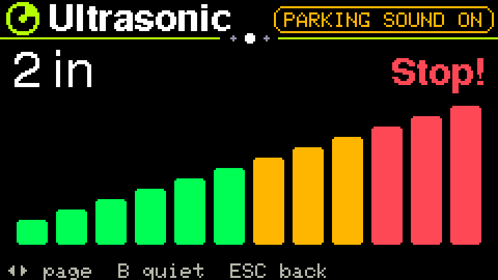 <b>Ultrasonic: parking.</b> Bars fill as you get closer. <b>B</b> adds beeps that speed up.</td>
</tr>
<tr>
<td width="33%">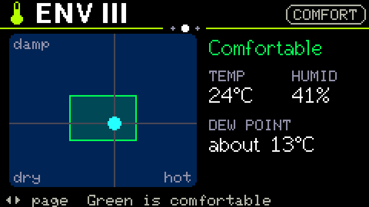 <b>ENV III: comfort.</b> A dot on a map of the room, and whether it feels right.</td>
<td width="33%">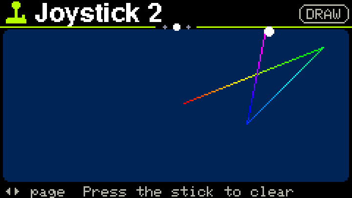 <b>Joystick: draw.</b> Steer a line around the screen. Press the stick to clear it.</td>
<td width="33%">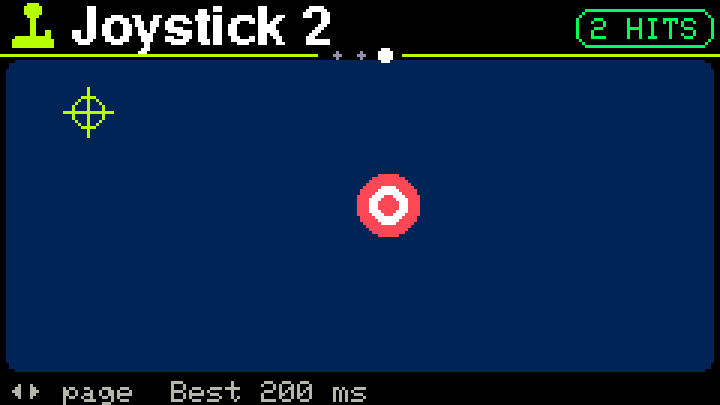 <b>Joystick: target.</b> Hit the target as fast as you can.</td>
</tr>
<tr>
<td width="33%">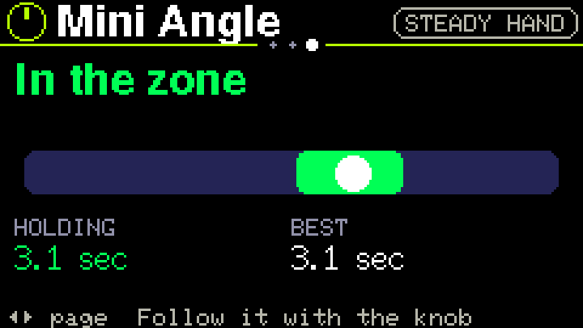 <b>Mini Angle: steady hand.</b> Follow the moving zone with the knob.</td>
<td width="33%">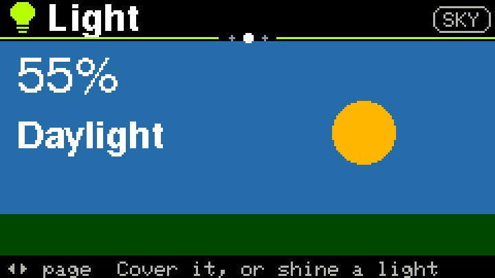 <b>Light: sky.</b> The sky follows the reading, from stars to full sun.</td>
<td width="33%">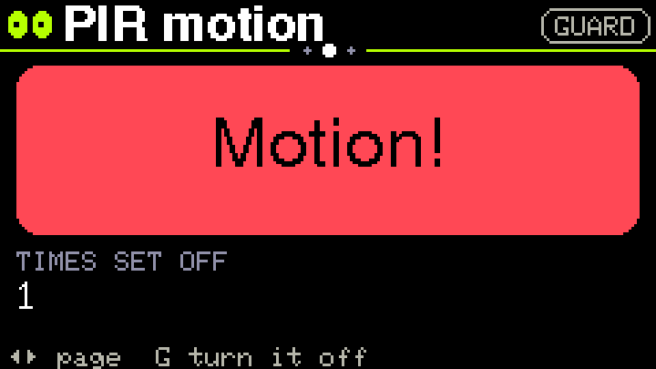 <b>PIR: guard.</b> <b>G</b> arms it, gives you 5 seconds to leave, then sounds the alarm until you press <b>G</b> again.</td>
</tr>
<tr>
<td width="33%">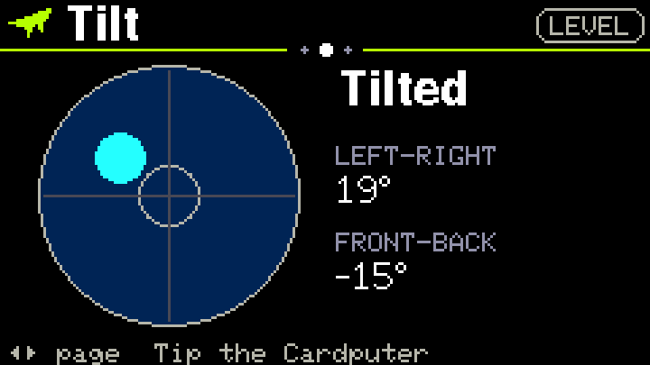 <b>Tilt: level.</b> A spirit level for both directions.</td>
<td width="33%">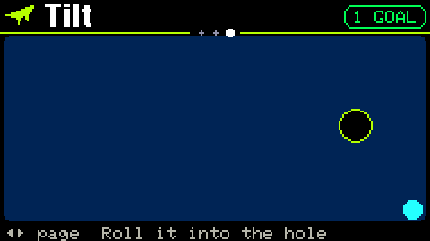 <b>Tilt: roll.</b> Tip the Cardputer and the ball rolls downhill. Get it into the hole.</td>
<td width="33%">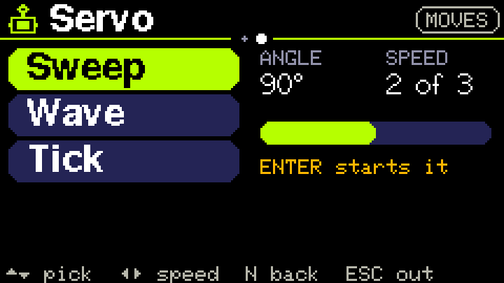 <b>Servo: moves.</b> Press <b>N</b>. Up and down pick a motion, left and right pick one of three speeds, and Enter starts it.</td>
</tr>
<tr>
<td width="33%">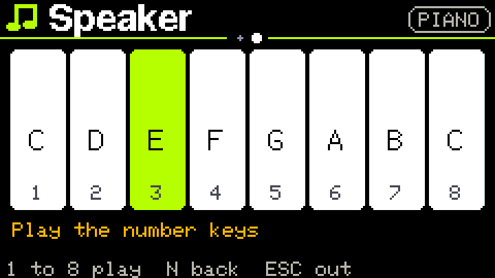 <b>Speaker: piano.</b> Turn the page, then play keys 1 to 8.</td>
<td width="33%">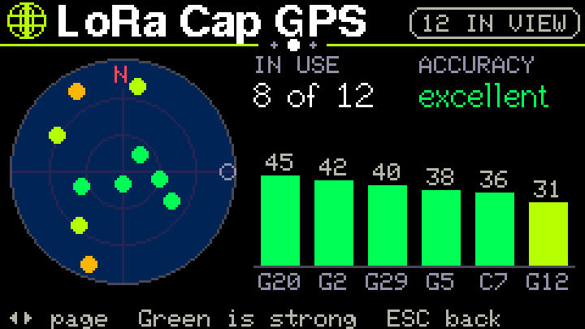 <b>GPS: sky.</b> Where each satellite is, and how strongly it's heard. Green is strong.</td>
<td width="33%">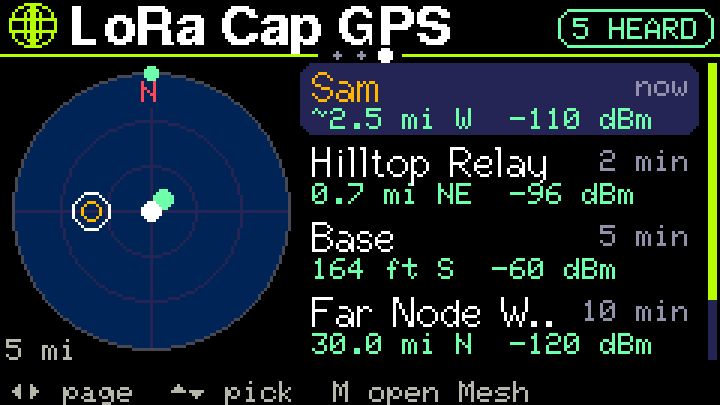 <b>GPS: mesh.</b> The radios Mesh heard, on a map around you. Up and down pick one.</td>
</tr>
</table>

Sounds and moves stop when you leave the page.

### The GPS, sky and mesh pages

The Cap LoRa-1262 holds a GPS and a LoRa radio, and **LoRa Cap GPS** has a page for each, as well as its own. Left and right turn them.

**The GPS.** North is always at the top of the compass, because the Cardputer has no compass of its own. The needle is the way you're moving, so it only shows above 3 km/h (2 mph). With a [spot saved](#gps-readings), the amber dot on the rim is the way to it, and **From spot** says how far and which way, like 364 ft S. The direction only shows once you're 10 m (33 ft) away, because closer than that the GPS's own wander swings it about. **Satellites** is how many the fix is using. Before there's a fix, the page shows how many it hears instead, and how many of those it's tracking.

**Sky.** Every satellite the GPS reports, placed where it is: the rim is the horizon, the middle is straight overhead, and the rings are 30° and 60° up. A filled dot is being tracked, colored by signal: green is strong, lime good, amber weak, and red too faint to use. An open dot is in view but not tracked yet. The bars are the six strongest, with their signal above and their name below: G is GPS, C BeiDou, R GLONASS, E Galileo and J QZSS. **In use** is how many the fix uses of all those in view, and **Accuracy** is how well spread they are: excellent or good means a few meters. Walls, roofs and trees block the dots on that side, so this is the page to watch while you look for a clear spot.

**Mesh.** The radios [Mesh](MESH.md#who-mesh-heard) heard, newest first, with how long ago, the signal, and how many hops a message took to reach you, or direct. The radio itself is off in the Lab, because it shares its wires with the SD card, so this is what Mesh heard while it was open. Leave Mesh open for a while to fill it, and press **M** to go there. A radio that shared where it is gets a dot on the map, with you in the middle, and its row says how far and which way. Up and down pick a radio, and the map zooms so the one you picked fits: the distance at the bottom left is the edge of the map, and anything further sits on the rim, in its direction. An open dot is a rounded spot, which many radios send on the public channel: the radio is somewhere in a box around it, and its distance has a ~ in front. People you've added in Mesh are amber. The list keeps eight, is only in memory, and is never in the Lab's file, the diary or what Claude sees.

## Build a rule

A rule has three pieces: what to **watch**, what to **do**, and how long to **keep going** afterwards. Open **Rules** and choose **+ New rule**. It asks one question a screen, and Esc goes back a step.

<table>
<tr>
<td width="33%">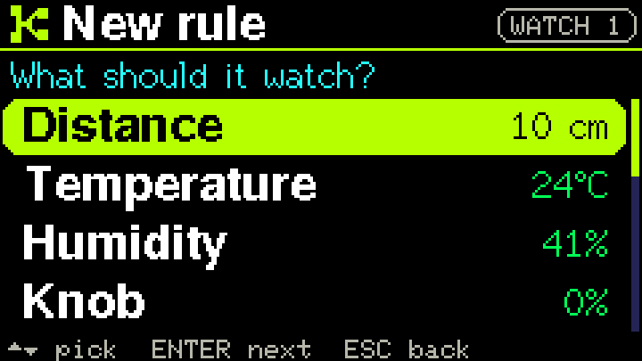 <b>1. What to watch.</b> Each sensor shows its live reading.</td>
<td width="33%">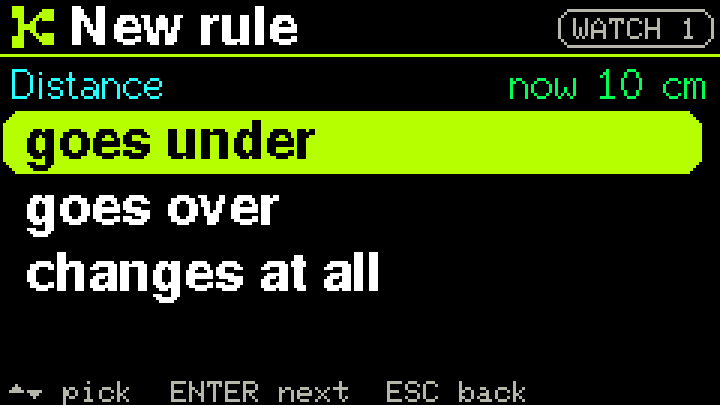 <b>2. When it counts.</b> Under a value, over it, or any change.</td>
<td width="33%"> <b>3. Show it.</b> Put your hand where you want it and press Enter, or nudge the number. Space goes back to the live reading.</td>
</tr>
<tr>
<td>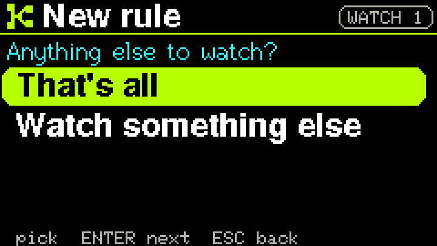 <b>4. Anything else?</b> Watch up to 3 things, then choose whether any or all must be true.</td>
<td>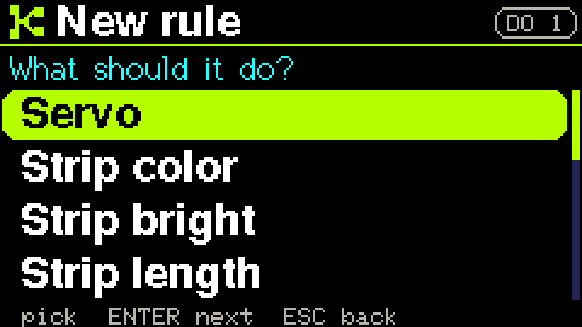 <b>5. What to do.</b> Pick an output. A rule can do up to 3 things.</td>
<td>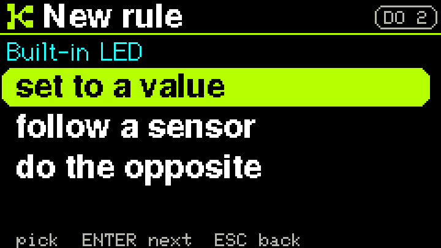 <b>6. How.</b> See <a href="#set-follow-or-do-the-opposite">the three choices</a> below.</td>
</tr>
<tr>
<td>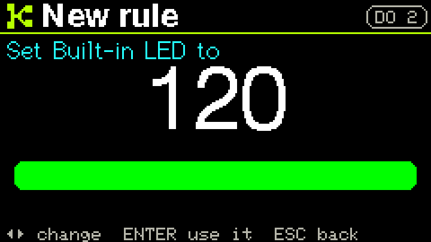 <b>7. The value.</b> The bar shows the LED's color as you change it.</td>
<td>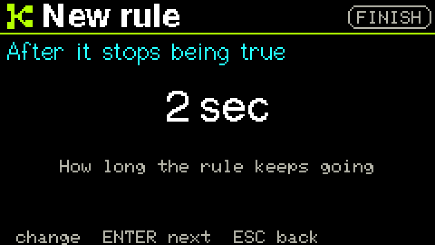 <b>8. Keep going.</b> How long it carries on once the condition stops being true.</td>
<td>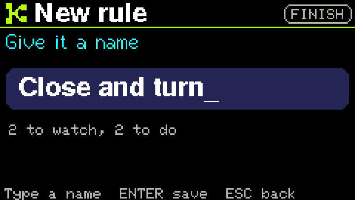 <b>9. Name it.</b> Enter saves it. Nothing is saved before this.</td>
</tr>
</table>

To change a saved rule, press Enter on it. It walks the same steps with your answers already picked, so change what you want and press Enter through the rest.

### Set, follow or do the opposite

| Choice | What it does | Try it with |
| --- | --- | --- |
| **Set to a value** | Goes to one value while the rule fires | Turn the strip red when someone walks in |
| **Follow a sensor** | Moves along with a sensor | The servo turns as you turn the Mini Angle |
| **Do the opposite** | Moves against a sensor | More LEDs light up as your hand gets closer |

Relays, lamp power and the air conditioners are simply on or off, so they can only be set.

### What a rule can use

| Watch | Do |
| --- | --- |
| Distance, Temperature, Humidity | Servo |
| Knob, Light, Motion | Strip color, Strip bright, Strip length |
| Stick X, Stick Y, Stick button | Relay 1, Relay 2 |
| Tilt, Satellites | Built-in LED, Speaker |
| Speed, Heading, From spot ([GPS](#gps-readings)) | Lamp power, Lamp bright |
| Its name, said aloud | TCL AC, Daikin AC |
| | Say a phrase |
| | Play a [sequence](#sequences) |

You can save up to 8 rules.

### Units

The Lab shows US units: °F, inches, mph and feet. To see °C, centimeters, km/h and meters, press Tab, open **Settings**, then **Device**, and set **Units** to **Metric**. Underneath, rules keep their numbers in metric, so switching only changes what you see, and a rule you saved before means the same afterwards. Claude is told which you read, so it answers in your units and converts when it writes a rule. A rule's number still moves in metric steps, so in °F it goes up one or two degrees at a time, and a distance an inch or two.

### GPS readings

With the Cap LoRa-1262 fitted and a fix, which needs the sky, rules can use three more readings besides **Satellites**:

- **Speed**, in mph, or km/h with metric [units](#units).
- **Heading**, the way you're moving: 0 is north, 90 east, 180 south and 270 west. A GPS standing still still names a direction, and it wanders, so Heading only reads above 3 km/h (2 mph).
- **From spot**, how far you are from a spot you saved, in feet, or meters with metric units. Stand where you want it, open **LoRa Cap GPS** in Devices and press **S** on its first page. Pressing S again somewhere else moves it. It stops counting at 32 km (20 miles). The GPS page also shows which way the spot is, with an amber dot on its compass.

With no fix, none of the three reads, so a rule waits rather than acting on an old position. The spot stays on the Cardputer: it isn't in the Lab's file on the SD card, and Claude only ever sees the distance. Rules only run while the Lab is open, so take the Cardputer along with rules playing.

### Recipes

Open **Recipes** from the Rules list. Enter adds one, and it's then a rule like any other, so you can change it.

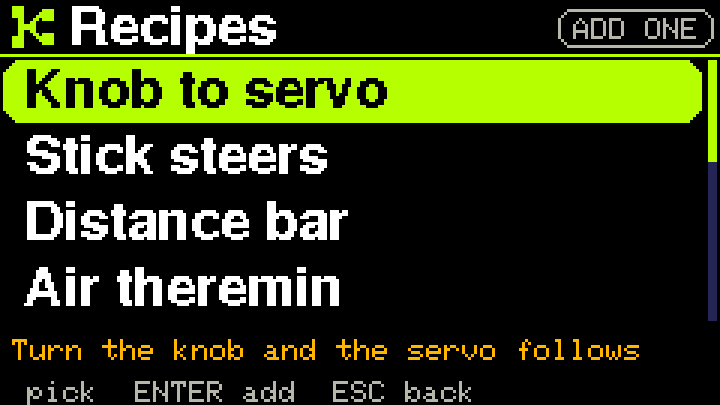

| Recipe | What it does | Parts |
| --- | --- | --- |
| Knob to servo | Turn the knob and the servo follows | Mini Angle, servo |
| Stick steers | Push the joystick to aim the servo | Joystick 2, servo |
| Distance bar | Closer lights more of the strip | Ultrasonic, LED strip |
| **Air theremin** | Move your hand to change the pitch | Ultrasonic |
| Night light | Warm strip when the room goes dark | Light, LED strip |
| Motion alarm | Someone moves: red strip and a beep | PIR, LED strip |
| Fan for damp | Humid air closes relay 1 | ENV III, relays |
| Tilt to servo | Tip the Cardputer to turn the servo | Servo |
| Dark lamp | Dark room turns the smartLamp on | Light, smartLamp |
| Hot room | A hot room, over 82 °F (28 °C), turns the TCL AC on | ENV III, TCL air conditioner |
| Speed beep | Going fast, over 16 mph (25 km/h), the speaker beeps | Cap LoRa-1262 |
| Near the spot | Near your saved spot: green LED | Cap LoRa-1262, with a [spot saved](#gps-readings) |

**Air theremin** is the cheapest place to start, because it needs one sensor and uses the Cardputer's own speaker.

## Play it

<table>
<tr>
<td width="50%">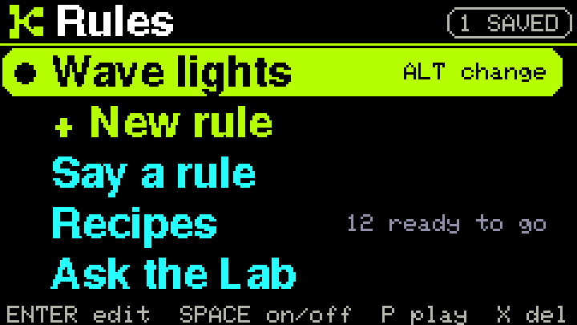 <b>Rules.</b> A solid dot means the rule is on. Space turns it off or on, <b>P</b> plays the ones that are on, and pressing X twice deletes one.</td>
<td width="50%"> <b>Waiting.</b> Sensors on the left, outputs on the right. The middle says whether <b>any</b> or <b>all</b> must be true. A single condition shows <b>IF</b>.</td>
</tr>
<tr>
<td> <b>Firing.</b> The true condition turns green, dots run along the wires, and the outputs show what they're doing.</td>
<td> <b>Paused.</b> Space pauses, and everything turns off until you press it again.</td>
</tr>
</table>

| Key | While playing |
| --- | --- |
| Left, right | Change rule. The dots at the bottom right stand for every rule, so you can see one firing on another page |
| **T** | Start Practice |
| Space | Pause, or carry on |
| Alt | [Call a rule by name](#call-a-rule-by-name) |
| Esc | Stop. Everything turns off, and opening the menu does the same |

Rules only run on this screen, because the Grove port can't be shared with other apps. The screen stays on while they play.

### Practice

Practice lets you try a rule with fake readings. Up and down change the highlighted sensor, left and right pick another, and Esc goes back to the real readings. Real outputs still move if they're connected, so it's also a good way to test a wiring job.

## Sequences

A rule decides **when**. A sequence decides **what happens, in what order**. Here's one that greets you: strip green, wait a second, servo to 90°, wait 2 seconds, servo back, strip off.

**Hello** is already in the list, and it only needs the Cardputer's own LED and speaker. Open **Sequences**, pick it and press **P**.

<table>
<tr>
<td width="33%"> <b>The list.</b> <b>P</b> plays one, Enter changes it, and pressing X twice deletes it.</td>
<td width="33%"> <b>Its steps.</b> They run from the top down. <b>P</b> tries it from here.</td>
<td width="33%"> <b>Playing.</b> Green is the step it's on. Esc stops it, and everything turns off.</td>
</tr>
</table>

### Build a sequence

Choose **+ New sequence** and it asks for the first step. A step either waits or does one thing, so two steps with no wait between them happen together. You can also [describe one](#write-a-sequence), and Claude writes the steps.

<table>
<tr>
<td width="33%"> <b>1. What it does.</b> Wait, or any output a rule can use except speech.</td>
<td width="33%"> <b>2. How.</b> Set a value, or turn it off. Turning any part of the strip off turns off the whole strip.</td>
<td width="33%"> <b>A wait.</b> Up to 10 minutes. What's on stays on.</td>
</tr>
</table>

On the list of steps:

| Key | What it does |
| --- | --- |
| Enter | Change a step, or use the row you're on |
| Left, right | Move a step earlier or later |
| **A** | Add a step after this one |
| **X** twice | Delete a step |
| **P** | Save it and play it |
| Esc | Save it and go back |

Below the steps, **Plays** chooses once or over and over, and **Name** names it. A sequence can have up to 16 steps, and you can save up to 8.

### Start one from a rule

When you build a rule, choose **Sequence** under What should it do, then pick one. It starts once, each time the rule starts firing.

<table>
<tr>
<td width="50%"> <b>Pick it.</b> This shows up once you've saved a sequence.</td>
<td width="50%"> <b>Watch it.</b> While it plays, the box shows which step it's on.</td>
</tr>
</table>

| If it plays | When the rule stops firing |
| --- | --- |
| **Once** | It finishes anyway |
| **Over and over** | It stops too |

To start a sequence by voice, give the rule **Its name** to watch, then [call it by name](#call-a-rule-by-name).

### How they share

- **One at a time.** A new sequence replaces the one playing. If that one was playing over and over and its rule is still firing, it picks up again afterwards.
- **A sequence wins what it has set.** Rules keep every other output, so a rule can run the strip while a sequence moves the servo.
- **Everything it turned on goes off when it ends**, so a forgotten last step can't leave a relay on. A servo stays where it stopped.
- **It only plays in the Lab.** Opening the menu or leaving the Lab stops it, the same as rules, and so does pausing them.

Every step goes through the same limits as rules: the strip's power limit, and how often relays and air conditioners can switch.

## Talk to it

With [Claude connected](../README.md#3-connect-claude), you can do most of the Lab by talking. Tap **Alt** to start listening and tap it again to send, and Esc cancels. The G0 button and Ctrl+V work the same way. The screen you're on decides what your words are for.

| On this screen | Alt lets you |
| --- | --- |
| **Say a rule**, in the Rules list | [Describe a new rule](#say-a-rule) |
| A saved rule, in the Rules list | [Change that rule](#change-a-rule) |
| Playing | [Call a rule by name](#call-a-rule-by-name) |
| Servo, LED strip, Cardputer LED or Speaker | [Set the part](#set-a-part-by-voice), or ask about it |
| Sequences | [Write or change a sequence](#write-a-sequence), or [ask the Lab](#ask-the-lab) |
| Devices, Dashboard, any other part or wiring | [Ask the Lab](#ask-the-lab), or [check something once](#check-something-once) |

Other Lab screens don't listen, such as an offer waiting for **Enter** or the steps of a new rule. **G0** and **Ctrl+V** do nothing there either.

All of this needs Wi-Fi and the bridge, and everything except calling a rule by name also needs Claude. If the screen says **Restart the bridge to use this**, your bridge is older than your firmware, so restart it.

### Say a rule

Describe what you want, and Claude writes the rule.

<table>
<tr>
<td width="33%"> <b>1.</b> Open <b>Say a rule</b> and tap Alt.</td>
<td width="33%"> <b>2.</b> Say what to watch and what to do, then tap Alt. Esc cancels.</td>
<td width="33%"> <b>3.</b> Check it. Enter saves it, E walks through it in the steps, and Esc drops it.</td>
</tr>
</table>

Nothing happens until you've looked at it. If Claude can't make a rule from what it heard, the screen says what it needs and what it heard. A rule you ask for [in the chat](#from-the-chat) arrives the same way.

A rule you say can play a saved sequence: "when someone walks in, play Welcome". Say a rule can't write the sequence itself, so [write that first](#write-a-sequence).

### Rules that talk

A rule can speak. Say "when someone walks in, say welcome back", and the Cardputer says it each time the rule starts firing.

A phrase can be up to 40 letters, once in a rule. Its speech is made when you save the rule and kept on the SD card, so it plays with no network, and a rule can't speak without a card. Sensors and rules wait while it speaks, and anything already on stays on. The steps can keep or remove a phrase, but only speech can add one.

### Call a rule by name

Ask for "when I say movie time, turn the strip blue", and you get a rule called Movie time that listens for its name. You can also build one in the steps, by choosing **Its name** under What should it watch.

<table>
<tr>
<td width="33%"> <b>1.</b> Play your rules. This one is waiting to hear its name.</td>
<td width="33%"> <b>2.</b> Tap Alt, say "movie time" and tap Alt again.</td>
<td width="33%"> <b>3.</b> It's on. Say the name again to switch it off.</td>
</tr>
</table>

This only needs your words, so it skips Claude. Rules wait while it listens, and what's on stays on. Only rules that listen for their name can be called, and stopping the rules forgets what was said. In Practice, you can fake saying it.

### Change a rule

<table>
<tr>
<td width="33%"> <b>1.</b> Pick a rule in the list and tap Alt.</td>
<td width="33%"> <b>2.</b> Say what should be different, like "make it stay on longer" or "only when it's dark".</td>
<td width="33%"> <b>3.</b> What changed stands out, and the rest is grey.</td>
</tr>
</table>

Enter replaces the old rule, E walks through it in the steps, and Esc keeps the rule you had.

### Ask the Lab

Stuck? Claude can see what's plugged in, the live readings, your rules and your sequences, so it answers about your own setup. Tap Alt on Devices, the Dashboard, a part's screen, the wiring screen or Sequences, or open **Ask the Lab** at the bottom of the Rules list.

- "Why didn't my rule fire?"
- "Why won't the strip light up?"
- "What can I make with these parts?"
- "Was there motion last night?"

<table>
<tr>
<td width="33%"> <b>1.</b> Tap Alt and ask.</td>
<td width="33%"> <b>2.</b> The answer shows on the screen and is read aloud.</td>
<td width="33%"> <b>Or pick a rule.</b> It can suggest up to three. Left and right move between them, Enter saves the one showing, and Esc drops them all.</td>
</tr>
</table>

### Write a sequence

Tap Alt on the Sequences list and describe the steps in order.

- "Flash the strip green three times."
- "Move the servo to 90, wait two seconds, then go back to zero."
- "Blink the LED red every three seconds, forever."

To change one, put the bar on it and say what's different, like "make it slower" or "make this one loop". You can also name one from any screen that asks the Lab: "make Door wave twice as slow".

Whatever comes back opens on [the same screen as one from the chat](#from-the-chat), where you can check every step. Enter saves it, E changes the steps first, and Esc drops it. Check the waits and values, because Claude can get a number wrong.

Claude can [play a saved sequence](#play-a-sequence) when you ask, but can't stop or delete one. For a rule that plays one, save the sequence first, then [say the rule](#say-a-rule).

### Set a part by voice

On the Servo, LED strip, Cardputer LED and Speaker screens you can say what to do, so your hands stay on the parts. Try "set it to 90", "make it blue and a bit brighter" or "a bit more".

A spoken setting only moves the part whose screen is open. To set another part from here, or to make it depend on a reading, [check something once](#check-something-once). Relays, the lamp and the air conditioner stay on their keys, because speech can be misheard and they can switch mains.

### The diary

The Lab keeps a diary while rules play: one line an hour with how many times motion was seen, how many times rules fired, and each sensor's lowest and highest reading. Leave rules playing overnight, then ask "was there motion last night?" or "how hot did it get?".

It's in `/lab/diary.txt` on the SD card. About the last day goes to Claude when you ask, and at no other time. Nothing is recorded while rules aren't playing, or if the clock hasn't been set. Delete the file to clear it.

## From the chat

You don't have to be in the Lab. On Pulse or in AI Chat, Claude knows every rule and sequence you've saved, so you can just ask, typing or talking.

- "What rules do I have?"
- "Make Wave red turn the strip blue instead."
- "Write a sequence that flashes the strip three times, then moves the servo to 90."
- "Make Door wave slower."
- "Play Happy birthday."

Whatever it writes opens in the Lab for you to check. Nothing is saved until you press **Enter**.

<table>
<tr>
<td width="50%"> <b>A new sequence.</b> Up and down scroll a long one. Enter saves it, E changes its steps first, and Esc drops it.</td>
<td width="50%"> <b>A change.</b> Grey is what stayed the same, and a changed name or fewer steps show on the line below. Enter replaces the old one, and Esc keeps it.</td>
</tr>
</table>

E doesn't save anything: after changing the steps, Esc comes back to this screen, and it can't play until it's saved. If you were typing when it arrived, it waits for the keys to rest for a second before it takes one, so your next message can't press Enter for you.

A rule looks the same as one you [said](#say-a-rule) or [changed by voice](#change-a-rule). A changed rule stays switched on or off as it was, and a changed sequence keeps its place, so any rule that plays it still does. Claude sends one at a time, so if you ask for several, save the first and it does the next.

| Claude can | You do it yourself |
| --- | --- |
| See your saved rules and sequences | See what's plugged in, with [Ask the Lab](#ask-the-lab) |
| Write a rule or change one | Start and stop rules, because they can switch mains |
| Write a sequence or change one | Delete a rule or a sequence |
| [Play a saved sequence](#play-a-sequence) | Stop it, with Esc, and press P for one that switches mains |
| [Check something once](#check-something-once): read a sensor, or set the strip, LED, servo or speaker | Switch relays, the lamp or an air conditioner, which only a rule you've saved can do |

A rule can't play a sequence until that sequence is saved. Ask for the sequence, save it, then ask for the rule.

This needs a bridge from 0.2.256 or later. On an older one, the chat can't see what's saved or write a sequence, so restart it.

### Play a sequence

Ask for a saved one by name: "play Happy birthday". Once Claude's reply has finished speaking, the Cardputer opens it in the Lab and plays it, the same as pressing P on the Sequences list, and Esc stops it. Rules that were playing stop first, as they do for P.

A sequence with a relay, lamp or air conditioner step opens ready on the list instead, and only plays when you press P, because those can switch mains. A live voice session can't play one, so ask in the chat afterwards. Needs firmware and a bridge from 0.2.260 or later.

## Check something once

You don't need a rule to ask about right now. On Pulse or in AI Chat, Claude can read a sensor or set a part straight away, without opening the Lab. Nothing is saved, and nothing keeps watching.

- "What's the knob at?"
- "How hot is it, and how humid?"
- "If the knob is over 50, turn the strip red."
- "If the light is under 20, turn the LED blue, otherwise turn it off."
- "Turn the strip off."

Claude says what it's checking, and a few seconds later the result arrives as the next message, like **Knob 67%, over 50. Strip set to red.** If you asked out loud, it's read out too. The reading comes from the Cardputer itself, so it's the real number. Ask "what did it read?" afterwards and Claude has the result.

An "if" means once. "When", "whenever" and "every time" keep watching, so those are a [rule](#say-a-rule), which waits for your Enter as usual. If it picks the wrong one, say which you meant.

The same works on any screen that [asks the Lab](#ask-the-lab), and the result shows there. With the Lab open, it uses the readings already on screen.

A check doesn't wait for Enter, so it can only reach parts where a mistake is easy to see and undo:

| Part | What happens |
| --- | --- |
| **LED strip** | Stays as set until you say "turn the strip off" or open the Lab. Asked in the Lab, it lasts until the Lab takes it back, as when a part's screen closes |
| **Cardputer LED** | The same |
| **Servo** | Moves, then lets go so it isn't left drawing power |
| **Speaker** | One short beep |

Relays, the lamp and the air conditioners can switch mains, so they aren't on that list. Claude offers a rule instead, and you check that before it's saved.

### What it needs

- **The Lab has to know the part.** Anything with no I2C can't be found by asking, so [open it in Devices](#connect-a-part) once first. Its setup is saved. On the I/O hub it uses the ports you picked, and the hub can't tell an empty port from a part, so an empty one can still give a reading.
- **It takes a second or two.** It waits for a spoken reply to finish first, and gives up after about 4 seconds if a part doesn't answer.
- **If a sensor doesn't answer, nothing changes.** You get "No reading from Knob. Nothing changed.", and it won't guess. A sensor it can't read means no action at all, even with several in the question.
- **A Mini Angle or Light on the I/O hub needs its range.** After a restart, open it in the Lab and turn it end to end once, or it says so and stops. Straight on Grove it doesn't need this.
- **It's one at a time.** One check runs until it's finished, and there are no waits or repeats. For those, ask for a [sequence](#write-a-sequence) or a rule.
- **The Grove port has to be free.** If Air Music, Flappy Bird, Hot Air Balloon, Ball Catch, NFC Notes, Sonar or Internet Radio has it, the check says so. Opening one of those, or the Lab, stops a check that's running.
- **Relays on Grove keep it out.** They'd switch with the port's traffic, so with them set up on Grove a check leaves the port alone, and only tilt, GPS, the Cardputer's LED and its speaker still work. It does the same if the Lab's setup can't be read from the SD card, or there's no card. Relays plugged into Grove that you haven't set up in Devices can't be seen at all, so set them up or unplug them first. On the I/O hub they're no trouble.
- **Not during rules or a live voice session.** With rules or a sequence playing in the Lab, or a sequence's screen open, they keep their parts and the check changes nothing. In a live voice session the Cardputer can't check anything, so ask in the chat afterwards.
- **It says what didn't happen.** If a part stops answering, or something else takes it back before the change goes out, the result says so rather than claiming it worked.
- **A strip or servo on Grove can flicker or twitch** as the port is checked, the same as when the Lab opens. The strip goes back to its color straight away.

Needs firmware and a bridge from 0.2.259 or later.

## On the bridge's page

While the Lab is open on your home Wi-Fi, [the bridge's web page](BRIDGE-UI.md) shows it live: every part it found and how it's wired, every reading, what each output is doing, which screen you're on, and which rules are firing. Open the page on a phone or computer and watch it follow along as you turn the knob or wave at the sensor.

<table>
<tr>
<td width="33%"> <b>Parts, on the bridge's page.</b> The part open on the Cardputer comes first, then the ones that are there.</td>
<td>The page draws each part as its test screen does: the distance with a graph of the last two minutes, the temperature and humidity, the joystick's dot, the knob's dial, the servo's angle, the strip's colors, the relays, the I/O hub's ports, the GPS and the built-in tilt, LED and speaker. Its dots mean what the Devices list's do. The Rules and Sequences tabs show what's saved, play a sequence, and build a rule with menus for you to check on the Cardputer.</td>
</tr>
</table>

- **It only goes over your home Wi-Fi.** The Cardputer sends to the bridge's computer directly, the way Podcasts and Cameras do at home. Away from home, nothing is sent.
- **About once a second while the page is open.** With nobody looking, it checks in every 15 seconds, so the page knows the Lab is open.
- **Your position isn't sent.** From the GPS, the page gets what rules use, like speed and the distance from your spot, plus how many satellites it hears and its height.
- **The first time on a network**, the Lab asks the bridge where it is at home. That waits while rules or a sequence play, so the page catches up once they stop.
- **If the bridge stops answering**, the Lab gives up after three tries and starts again next time you open it. The Lab itself carries on as usual either way.

Needs firmware 0.2.326 or later, and the bridge's page turned on.

### Control parts from the page

The page's part cards have controls too: the servo's angle, the LED strip's color, brightness and length, the Cardputer's LED, a beep from the speaker, both relays, the smartLamp's power and brightness, and the TCL and Daikin air conditioners. A tap reaches the Cardputer with its next report, within about a second, and the card says whether it worked.

- **Relays, the lamp and the air conditioners switch with no confirm.** From Claude, those always wait for you on the Cardputer: a rule or sequence is checked before it's saved, a sequence that switches them only plays when you press P, and a check from the chat can't touch them. The page switches them straight away, because you asked for it to work that way. Mind what's plugged into the relays.
- **Only while the Lab is open, at home.** The controls ride the same reports as the live readings, so with the Lab closed or the Cardputer away from home, nothing goes.
- **With a part's screen open, the screen follows.** Set the servo from the page with the Servo screen up and its angle moves there too, and a sweep stops.
- **It lasts until the Lab takes it back:** that part's screen or another one closing, rules playing, or a sequence driving the same part. When the Lab closes, everything the page turned on goes back to rest, the relays, lamp and air conditioners included.
- **Some things it says no to:** while rules play, since they decide every part; on a sequence's own screen; for a part a running sequence is driving; for a servo, strip or relays that aren't set up in Devices; and for anything past a part's range.
- **The speaker beeps once** for each tap, and never keeps playing.

Needs firmware 0.2.330 or later.

## If a part doesn't answer

The Lab tells you where to look, and units reconnect by themselves.

<table>
<tr>
<td width="33%"> <b>Others still answer.</b> The port is fine, so check that part's cable.</td>
<td width="33%"> <b>On an I/O hub port.</b> I2C units can't go there. Use the 1-to-3 hub.</td>
<td width="33%"> <b>Sharing the wires.</b> Plug in the I/O hub, or unplug the I2C unit.</td>
</tr>
</table>

| What you see | What to try |
| --- | --- |
| Nothing answers at all | Check the cable into the Grove port, then try one part by itself |
| A part on the I/O hub doesn't respond | Open it, press **P** and pick the port it's really in |
| The Light reads backwards | Press **F** on its screen |
| The strip flickers or shows the wrong colors | Press **T** on its screen to try other timing |
| The Cardputer restarts when the strip or servo moves | It's probably a power problem. See below |

To see what the Lab finds as it happens, connect USB and run `python scripts/cardputer.py monitor`. Its messages start with `[LAB]`.

## Good to know

- **Watch the power.** The strip and the servo run off the Cardputer's Grove power, and M5Stack doesn't publish a limit for it. At full white, 30 LEDs can draw 1 A, and a stalled servo 750 mA. The strip's limit starts at 25%, so keep it low. If the Cardputer restarts, give the strip its own 5 V supply and join the grounds.
- **Rules live on the SD card**, in `/lab/rules.dat`, along with your hub wiring. Sequences are in `/lab/seqs.dat`, and rules' speech is in `/lab/say`. They survive a firmware install. With no card, rules and sequences last until the next restart, and the chat can't see them until the Lab has been opened.
- **When two rules want the same output**, the lower one in the list wins.
- **Internet Radio uses the knob and the strip** when Devices last found them on the Grove port: the knob tunes and the strip shows the music, while the radio's screen is open. It reads where they are from your setup, so set them up here first. See [Internet Radio](RADIO.md#a-knob-and-an-led-strip).
- **A relay can switch about three times a second at most**, however much a sensor flickers.
- **The smartLamp and air conditioner are left alone until a rule asks.** When that rule ends or you stop, an "on" that it sent is undone. An air conditioner changes at most every 3 seconds. It sends by infrared, so point the Cardputer at it.
- **The Lab is new.** It's still being tuned on real parts, and some fixes have only run against simulated ones, so a part may behave differently from these pictures. If it does, the USB log above is the best place to start.

These are real screens: the firmware's own drawing code, run on a computer against simulated parts. They're shown three times their actual size.

For every key in one place, see [Everyday controls](CONTROLS.md#lab). Back to the [README](../README.md).
