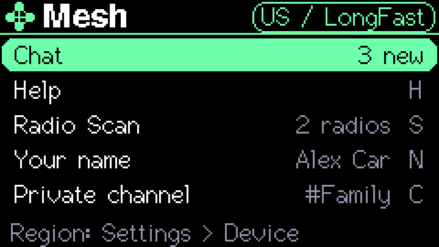
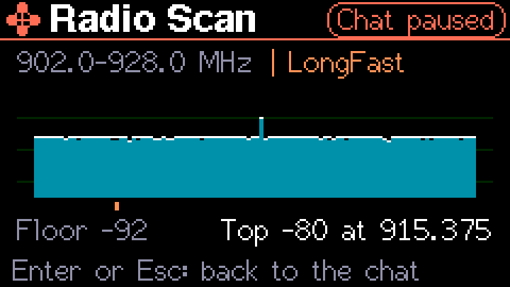
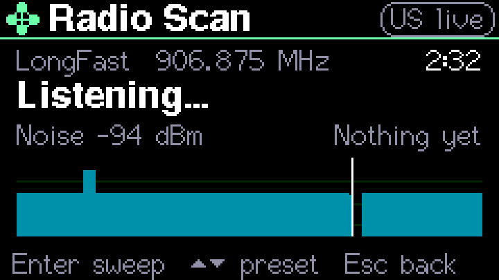
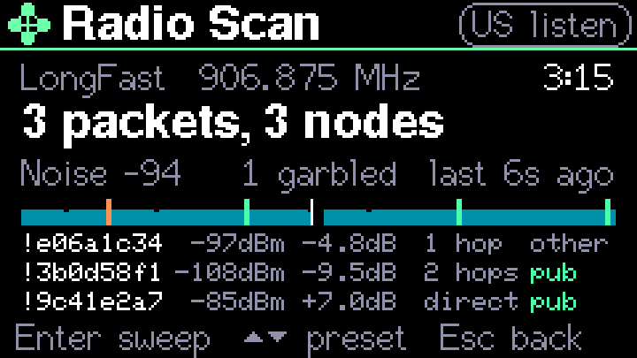

# Mesh on S1-ADV

The Tools → Mesh application adds a Meshtastic leaf client to S1-ADV on the
Cardputer ADV with Cap LoRa-1262. It preserves the existing applications and
8 MB dual-OTA partition layout. It does not replace S1-ADV with the standalone
Meshtastic firmware.

Besides the public channel, it has a [private channel](#private-channel) for a
group that shares its key, sends direct messages that only one person's
radio can read, says whether each one arrived, and has **Help**: one key sends
a ready message with where the Cap's GPS puts you to everyone you've saved, and
sends it again every five minutes until one of their radios has it. It's meant
for when your phone is dead or has no signal and someone you know has a
Meshtastic radio.

Attach the antenna before powering the Cap. Since 0.2.303 the radio comes on
as soon as Mesh opens and stays on until you leave Mesh, so every Mesh screen
runs on top of a radio that's hearing and saving messages: the first screen,
the chat, People, Help, Radio Scan, your name and the private channel. Only the
sweep and listening with another preset in [Radio Scan](#radio-scan) pause the
chat, and the screen says so in red. Before 0.2.303 the first screen, the name
and the private channel all had the radio off.

The first screen is a list, like the menu's: Up and Down pick a row, Enter opens
it, and the line at the bottom says what the row picked does. Each row also has
its own key, which opens it straight away. The band in the top bar turns green
once the radio is hearing.

| Row | Key | What it does |
| --- | --- | --- |
| Chat | Enter | Opens the chat. The row shows the channel's frequency, or in green how many messages came in while the chat wasn't on the screen |
| Help | H | Opens [Help](#help) |
| Radio Scan | S | [Radio Scan](#radio-scan): what the radio hears, live. The row shows how many radios it has heard |
| Your name | N | [Your name](#your-name) on the mesh, shown in the row |
| Private channel | C | Sets up the [private channel](#private-channel), shown in the row |

The Cardputer's own arrow keys are `;` `.` `,` and `/`, and they send those
characters, not arrows. Where Mesh has nothing to type into (the first screen,
People, a message opened with Ctrl+O, Radio Scan), Up and Down (`;` and `.`)
move without Fn. In the chat all four type, and Fn with them moves. Left and
Right (`,` and `/`) change who a message goes to, so they always need Fn. A USB
keyboard's arrows work everywhere. Before 0.2.300 these keys always typed, so
only a USB keyboard could change who a message went to or move through People.

Every Mesh screen has the bar along the top that the menu and the Lab have,
and the text is in the 16-pixel font rather than the 8-pixel one. Names and
messages in other scripts, and emoji, are drawn in the 12-pixel font, as they
were before. A notice, such as "Location queued" or "Outbox full", shows on
orange at the bottom in place of the keys until it's done.

Esc goes back one step at a time. It closes whatever is open (a message, People
or Help), gives a radio Radio Scan borrowed back to the chat, and takes the chat
or Radio Scan back to this first screen, with the radio still on. Help opened
from the first screen goes back there. Esc on the first screen leaves Mesh,
which turns the radio off, so it asks first: the bottom line says "Esc again
turns the radio off", or "Help is on. Esc again ends it" while Help repeats, and
a second Esc within four seconds leaves. Until 0.2.302, Esc with the radio on
went straight Home, and in 0.2.302 it turned the radio off on the way back to
this screen. Esc while the radio is still starting leaves at once; that waits
for the worker to finish before releasing the radio or restoring SD.

The radio can't start while the Cardputer checks for updates, the weather or
messages in the background. Since 0.2.302 those checks don't start while any
Mesh screen is open. One may already be running when you open Mesh, for
example straight after coming from Home. The bottom line then says "Finishing a
background check" and the radio starts by itself once it's done. Before 0.2.302
Mesh refused with "Finish current task first", which happened most often just
after leaving the radio, when the checks that had waited all ran at once.
Anything else in the way is named instead, and the radio stays off until you
pick Chat, Help or Radio Scan again: "Stop the radio or podcast first", "Wait
for Claude's reply", "Finish recording first", "End the voice chat first", "Wait
for the update to finish" or "Stop what's playing first".

## Shared hardware

Mesh exclusively owns the shared SPI bus while it's open, since its radio is on
the whole time. SD-dependent audio,
voice, notes, files, assets and NES applications are temporarily unavailable.
RFID and Sonar also conflict with the Cap's GPIOs. Exit Mesh before using these
applications. Selecting another non-conflicting application stops Mesh first.
The SD is remounted after radio shutdown, including failed initialization.
No files are formatted or deleted. Mount failure is reported separately from
radio state; internal storage becomes available again after leaving Mesh.

Network-heavy polling and voice services pause during Mesh. Pomodoro time,
alarms, battery and SmartLamp servicing continue. Mesh doesn't run in the
background alongside those applications.

The Cap's GPS is on its own serial port, so Mesh reads it while the radio runs.
Contacts and the name are kept in NVS, and the chat history in the Cardputer's
internal flash (LittleFS), never on the SD card.

## Region

Mesh uses Meshtastic's US region unless you pick another: LongFast public
channel, 906.875 MHz, 250 kHz, SF11, CR4/5. Pick yours in Settings → Device →
**Mesh region** with Left and Right (Enter steps forward too). The Mesh screen
shows the region and its channel, and the radio keeps the region it started
with until you leave Mesh, so a change takes effect the next time you open it.

The list holds the Meshtastic regions inside the band M5Stack rates the Cap for,
868 to 923 MHz (the AS923 channels), all on their LongFast channel:

| Region | Channel |
| --- | --- |
| US (default) | 906.875 MHz |
| ANZ | 919.875 MHz |
| BR_902 | 903.875 MHz |
| EU_868 | 869.525 MHz |
| JP | 923.375 MHz |
| KR | 922.875 MHz |
| MY_919 | 922.875 MHz |
| PH_868 | 869.375 MHz |
| PH_915 | 917.875 MHz |
| RU | 869.075 MHz |
| SG_923 | 917.875 MHz |
| TH | 923.875 MHz |
| TW | 923.875 MHz |
| UA_868 | 868.375 MHz |

Regions below 868 MHz (IN, NZ_865, KZ_863, NP_865, EU_866), the 433 MHz and
2.4 GHz regions, and the licensed amateur bands are left out. Picking a region
in software doesn't make transmitting legal where you are, so check your local
rules. Until 0.2.269 Mesh was fixed to TH.

## Chat

The chat runs on the region's LongFast public channel, the one every Meshtastic
radio uses out of the box.

- Type, and Enter sends up to 200 UTF-8 bytes. The box at the bottom starts with
  who it goes to: `Public>` or a contact's name. Fn with Left or Right (`,` or
  `/`) changes who.
- The last two messages show as bubbles: what you sent on violet, to the right,
  and what you heard on navy. A long one is cut with two dots; Ctrl+O shows it
  whole, in the bigger font if it fits in five lines and the smaller one if not.
- Ctrl+N opens [People](#people-and-direct-messages), Ctrl+O opens the selected
  message, Ctrl+L [shares your location](#sharing-a-location) and Ctrl+H opens
  [Help](#help). Fn with Up or Down (`;` or `.`) moves through the messages, and
  the chip at the top right then says which one, such as `7 of 8`. In a message
  opened with Ctrl+O, Up and Down work without Fn. The bottom line shows these
  keys in two halves, taking turns, and while Help repeats, it says when the
  next round goes, on red.
- A message for you is labelled `Sam > you`. One on the public channel shows
  only who sent it. Public messages are public: anyone with a Meshtastic radio
  in range can read them, and radios with an internet link upload what they
  hear, so a public message can end up on maps such as meshmap.net.
- The history holds the last 30 messages and sixteen radios heard. The
  messages are kept on internal flash, so they're still there after Mesh closes
  or the Cardputer restarts. The radios heard aren't. Until 0.2.303 it held
  eight messages.
- A message that arrives while you're on another Mesh screen, such as People,
  Help or Radio Scan, shows as "Message from Sam" at the bottom for a few
  seconds, and the first screen's Chat row counts it, in green, until you open
  the chat. It also makes its usual sound.
- Transmit power is 20 dBm, the most M5Stack rates the Cap for. Until 0.2.275
  it was 10 dBm. The library applies regional airtime accounting and carrier
  sensing. These software settings don't certify an antenna or regulatory
  approval.
- The device identity is generated once and retained in NVS, independently of SD.

The radio sends one message at a time, so the next one waits its turn. Under
each message you sent, the chat says what became of it:

| Shown | For a direct message | For a public message |
| --- | --- | --- |
| waiting | Behind another message | Behind another message |
| sending | On the air, tried up to five times | On the air, tried up to three times |
| relayed / heard nearby | Another radio repeated it on its way | Another radio repeated it, which is all anyone can know for a public message |
| delivered | The person's own radio said it arrived | (never) |
| not confirmed | Repeated on the way, but their radio never answered | (never) |
| no answer / not heard | No radio repeated or answered any try | No radio repeated any try |
| failed | Refused, with the reason, such as "they don't have your key yet" | Refused here |
| unknown | Still going when the Cardputer restarted | The same |

"Delivered" means it reached their radio, not that they've read it. Their radio
answers on its own main channel, so if they moved theirs off LongFast, a message
that arrived can still show "not confirmed".

The client receives channel text, direct messages, acknowledgements and node
announcements, and sends text, positions and its own NodeInfo (15 seconds after
the radio starts, then every three hours). It doesn't relay other radios'
packets or provide the Meshtastic phone API. Chat stays on its region's LongFast
channel, which the private channel shares; [Radio Scan](#radio-scan) is the only part that tunes anywhere else, and
it only listens. Received radio text is display data and is never executed as a
device or agent instruction. Nothing heard on the radio acts on its own: it can
only chime and wake the screen.

## People and direct messages

Ctrl+N lists your contacts first, heard lately or not, then every other radio
heard this session, with its signal and how long ago it was heard, three to a
page. Up and Down pick one, without Fn, since People has nothing to type into.

- **Enter** saves the selected radio as a contact. It needs that radio's public
  key, which comes in its NodeInfo. A radio announces itself when it starts and
  every few hours, so "no key yet" usually means restarting their radio near the
  Cardputer.
- **Del** removes the selected contact.
- Up to four contacts. A contact keeps the key it was saved with. If their radio
  later announces a different one, the saved key stays and the log says so.

A message to a contact is a Meshtastic direct message, encrypted to their key so
only their radio can read it, and it asks their radio to confirm it arrived. For
them to read it, their radio must also have heard this Cardputer announce itself.
That happens 15 seconds after the radio starts here, and again whenever a radio
says it lacks this Cardputer's key. A direct message to you is decrypted with a
contact's saved key, or with the key of any radio heard announcing itself, and
it chimes and wakes the screen.

The other person needs any Meshtastic radio with the Meshtastic app, set to the
same region and left on the default LongFast channel.

## Help

H on the first screen, or Ctrl+H in the chat, opens Help. It shows the GPS
(a fix and its satellites, how old the last fix is, or none), the battery, and
who it sends to.

| Key | Sends |
| --- | --- |
| 1 | Out of gas. Please come and get me. |
| 2 | Car trouble. I need help. |
| 3 | My phone is dead. Reply here. |
| 4 | I'm OK now. No help needed. |

Each message ends with where you are, as a map link most phones open:
`Location: https://maps.google.com/?q=42.51912,-70.89645`. A fix older than
two minutes says how old it is, and with no fix in the last hour it says
`No GPS fix.` The GPS needs open sky. Indoors it may never get a fix.

- It goes to every contact as a direct message, and to the
  [private channel](#private-channel) if there is one. **C** leaves the private
  channel out, or puts it back. With nobody else to send to, it goes to the
  public channel instead. **P** sends it to the public channel as well.
- Contacts and the private channel get exactly where you are. The public channel
  gets only what [Public location](#public-location) allows, which is nothing
  unless you change it.
- The `To:` line says who the next one goes to, and how much the public channel
  gets: `To: Sam, #Family, public (rough)`.
- 1, 2 and 3 repeat every five minutes until one contact's radio says a message
  arrived, a contact or anyone on the private channel writes back, or anyone
  sends you a direct message. Talk on the public channel doesn't stop it, and a
  channel message can only ever be heard, never confirmed. The screen shows each
  contact's latest message, then the channels', and when it goes again.
- 4 goes once and ends Help. Pressing another number changes the message.
- Esc goes back to where Help was opened from, the chat or the first screen,
  and leaves Help running. The chat's top line then says `Help on, again in
  4:12`. Leaving Mesh would end it, so Esc on the first screen says so first.

To save the battery while you wait, the screen turns off 30 seconds after the
last key while Help repeats. Any key brings it back, and so does a message for
you or from a contact. The rest of the time in Mesh, the screen turns off after
the device's own screen-off time, if Settings → Display → Auto screen off is on.

## Sharing a location

Ctrl+L sends where the GPS puts you to whoever Enter sends to: a Meshtastic
position, which puts you on their app's map, and a text with the map link. With
no fix, it says so and sends nothing.

- A contact gets it exactly, encrypted to their radio.
- The private channel gets it exactly, on that channel only.
- The public channel gets only what [Public location](#public-location) allows.
  When that's on, it asks for a second Ctrl+L within four seconds first.

Before 0.2.279, Ctrl+L with the private channel picked sent the map pin to the
public channel at full precision, and only the text to the private channel.

### Public location

Settings → Device → **Public location** decides how much of where you are goes
on the public channel, from Ctrl+L or from Help. Left and Right, or Enter, step
through:

| Setting | The public channel gets |
| --- | --- |
| off (the default) | Nothing: Ctrl+L refuses, and Help sends its message without the location |
| rough | A spot within about 3 km: `Location within 3 km: https://maps.google.com/?q=42.49,-70.91`, and a map pin the Meshtastic app draws as a box |
| exact | Exactly where you are, as contacts get it |

Rough is how Meshtastic does it: each coordinate keeps its top 13 bits and moves
to the middle of the box that leaves, about 5.8 km from south to north. The
real spot is anywhere in that box, so it's within about 3 km of the one sent.
Anyone near you hears the public channel, and radios with an internet link
upload it, so the spot can end up on maps like meshmap.net.

### Who Mesh heard

While Mesh is open it notes the last eight radios it heard: the name each gave,
its signal, how many hops it came over, and the spot it last shared, if it
shared one. The Lab's **LoRa Cap GPS** has a page for them, with a map around
you and how far and which way each one is (see
[the Lab guide](LAB.md#the-gps-sky-and-mesh-pages)). The radio is off in the
Lab, so it shows what Mesh heard, with how long ago. The list is only in
memory: it's never saved, logged or sent to Claude, and it's gone when the
Cardputer restarts.

## Your name

N on the first screen edits the name other radios show for this Cardputer, up to
39 bytes. Enter saves it and Esc leaves it as it was. Meshtastic's short name is
made from it: the initials of two words or more, or the first four letters of
one. Left empty, it's `S1-ADV` and `S1`, as before 0.2.275. Since 0.2.303 a new
name goes out at once: the radio announces it straight away. Before, it waited
until the radio next started.

## Private channel

A private channel is a group chat that only radios with its key can read, such
as your family's. It runs alongside the public channel on the same frequency,
the way the Meshtastic app adds a secondary channel, so public messages, direct
messages and their receipts all carry on. Mesh holds one.

Set it up with **C** on Mesh's first screen. Since 0.2.303 the radio stays on
while you do:

- **N** names it: up to 11 letters, digits, spaces, `-` or `_`. Every radio on it
  uses exactly the same name.
- **G** makes a new random key and shows it. G on a channel that already has a
  key asks for a second press, because everyone else has the old one.
- **K** types a key instead, as base64, the way the Meshtastic app shows it: 16 or
  32 bytes. The app's one-byte keys like `AQ==` and Meshtastic's default key are
  refused, because every radio knows them.
- **V** shows the key as text and as a QR code. A phone's camera reads the code,
  so the key can be pasted rather than copied by eye, where I and l look alike.
- **X** twice removes the channel. Esc leaves.

On a phone with the Meshtastic app, add a channel under Channels with the same
name and paste the key. Leave the phone's first channel as LongFast: Mesh's
public channel is always the region's LongFast default, and making the private
channel a phone's first channel would move that phone to another frequency.

In the chat, Fn with Left and Right steps through Public, then `#Name`, then each contact.
Messages on it are labelled `#Family Sam` and `You > #Family`, and like a direct
message, one arriving chimes and wakes the screen. Delivery reads as for the
public channel: "heard nearby" once another radio repeats it.

The name and key are kept in the Cardputer's own flash with Mesh's other
settings: never on the SD card, in a log or anywhere else. Anyone who sees the
key can read the channel. As with every Meshtastic channel, who sent a message
isn't hidden, only what it says. A change takes effect at once, without the
radio restarting, and removing the channel moves the chat back to the public
channel if that's where it was sending. Before 0.2.303 a change waited until
the radio next started. Since 0.2.279, [Help](#help) goes to the private channel too unless you
turn it off, and [Ctrl+L](#sharing-a-location) sends it your exact location.

This needs a small change to libmeshtastic-leaf, which held one channel at a
time; see [Source and licensing](#source-and-licensing).

## Radio Scan

Press S on the Mesh screen. Radio Scan never transmits. Since 0.2.303 it opens
**live** on the chat's own channel, through the chat's own radio: it counts
every packet that radio reads, including ones the chat can't open, and shows
the channel's signal, while the chat carries on receiving and saving messages
underneath. The top bar's chip says `US live`. Before 0.2.303, Radio Scan
turned the chat off and had a radio of its own.

The sweep and listening with another preset have to move the radio off the
chat's channel, so they borrow it, and anything sent to you meanwhile is
missed. The bar turns red and its chip says **Chat paused**, and borrowing
clicks twice down; giving it back clicks twice up. Radio Scan won't borrow the
radio while Help is repeating ("Not while Help is on") or while a message is
still going out ("Wait: a message is going out").

- **Enter** borrows the radio for a sweep of the band. Enter again, or Esc,
  gives it back.
- **Up** and **Down** borrow it to listen with another preset: MediumFast,
  MediumSlow, LongModerate, ShortFast and ShortSlow. Round to LongFast again,
  or Esc, gives it back. Some local meshes use another preset, but the chat
  only ever talks on LongFast.
- **Esc** on the live view goes back to the first screen, with the radio on.

The **sweep** reads your region's band (Settings → Device → Mesh region), one
250 kHz channel at a time. US is 902 to 928 MHz in 104 steps. A region
narrower than 8 MHz, such as EU_868, is shown 8 MHz wide around its band.

- Each bar is the latest reading on that channel, from -130 dBm at the bottom
  to -60 dBm at the top. The white tick above it is the strongest reading
  lately, falling 2 dB a second, so a short burst stays visible for a while.
- The orange mark under the chart is the region's LongFast public channel.
- **Floor** is the middle reading of the band, roughly the background noise.
  **Top** is the strongest recent reading and its channel.

A LongFast packet lasts about a second and most meshes are quiet between
packets, so a sweep shows bursts rather than a steady signal. Other devices
share the band too, so a burst isn't necessarily Meshtastic.

**Listening**, live on LongFast or borrowed on another preset, counts the
packets the radio hears, whoever sent them and whatever channel they're on.
The live view counts from when the radio came on; each other preset starts
counting afresh.

- The top lines count packets, the senders they came from (up to 32, then
  `32+`) and **garbled** ones: too short to be Meshtastic, or damaged on the way.
- Each row is a packet, newest first: the sender's node ID, its signal strength
  and SNR, how many hops it made (`direct`, a number, or `hops ?` from older
  firmware), and `pub` when it's on that preset's default public channel,
  `priv` when it's on your [private channel](#private-channel) (live only), or
  `other` for any other channel, which is often someone else's private one.
While it listens, it shows how it's going, so a quiet channel doesn't look like
a stuck radio:

- The top line has the preset and its channel, and on the right how long it has
  listened there: `4:12`, then `1:04:12` after an hour. Live, that's since the
  radio came on; another preset starts again at `0:00`.
- **Noise** is the channel's background level, the middle of the last minute's
  readings. On the right is when it last heard something, with how many were
  garbled, or `Nothing yet`.
- The chart is the channel's signal on the sweep's scale, a column every half
  second, holding the last 56 seconds. The **white line** is where it's writing
  now. It moves right and starts again at the left, with a small gap ahead of
  it, so it moves even when nothing is heard. If it moves, the radio is
  listening.
- A **rise** is something sending on the channel. A **green mark** at the top
  means a Meshtastic packet came in then, and an **orange** one a garbled one.
  A rise with no mark is something else on the channel, or a packet too damaged
  to read. A mark with no rise is normal: LoRa reads packets weaker than the
  noise, which the chart can't show.
- Once a packet has arrived, the chart gets shorter and the latest three
  packets show under it.
- Meshtastic radios send on their own now and then, even when nobody types, so
  give it about half an hour before deciding nobody is in range.

- Only the 16-byte header every Meshtastic packet sends unencrypted is read for
  these counts. Nothing is decrypted or shown as text here, and nothing heard is
  ever treated as an instruction. Reading messages is what Mesh chat is for.

If a borrowed radio stops answering, the screen says so and Radio Scan stops
using it; borrowed and listening, it notices from the chart's readings within
about half a second. Esc then gives it back to the chat. A radio that won't go
back to the chat is turned off, and the first screen says "Radio stopped
answering".

## Sounds

Since 0.2.301 Mesh says what happened by ear, so it can stay in a pocket. Each
sound is a few short notes, a quarter of a second at most, told apart by rhythm
as much as pitch because the speaker is small. Talk on the public channel stays
quiet, as before.

| Sound | When |
| --- | --- |
| Three notes up | The radio is on and listening (chat or Radio Scan) |
| Three notes down | The radio went off |
| A quick run of ticks up | A message or your location is on its way |
| One small bell | A message on a channel was repeated by another radio, which is all a channel can tell |
| Two bells up | A direct message reached their radio |
| Two low notes down | A message didn't get there, or the radio wouldn't start or stopped answering |
| A high note twice, like a doorbell | A message for you, or from a contact |
| High, lower, high | A message on the private channel |
| Three even beeps, the loudest | Help is going out |
| One soft tick | Help went out again |
| Four notes climbing | Someone has your Help: their radio confirmed it, or they wrote back |
| A ping and its echo | A contact's radio is heard for the first time since Mesh started |
| Two quick high blips | The GPS has a fix, or has one again after two minutes without |
| A rising question | Press again to be sure: Esc while Help repeats, the public channel's location, a new key or removing the channel |
| Two dull knocks | That can't be done, such as Ctrl+L with no GPS fix or a full outbox |
| Two clicks up, or down | Saved or switched on, removed or switched off |

In Radio Scan's listening mode every packet heard ticks, higher the stronger it
came in: from 500 Hz at -125 dBm to 2 kHz at -55 dBm. Walking toward a radio,
the ticks rise.

Settings → Device → **Mesh sounds** turns them all off; it's on unless you
change it. Their loudness is Settings → Device → Notify volume, like the rest of
the device's sounds. They only play while nothing else has the speaker, so
they never cut into the radio, a podcast or voice, and a sound that matters more
cuts off a Mesh sound that matters less. Before 0.2.301 Mesh only beeped, once,
for a message for you and for Help answered.

## Checks

`scripts/test_mesh_leaf_state.py`, `test_mesh_lifecycle.py`, `test_mesh_radio.py`
and `test_mesh_ui.py` exercise the production state, lifecycle, radio setup and
240×135 renderer. `test_mesh_sounds.py` renders every sound with the firmware's
own code and checks its length, level, ends and notes; `MESH_SOUNDS_WAV=<folder>`
writes them as WAV files to listen to. The lifecycle test checks which sound each
key and delivery state makes. `test_mesh_messaging.py` checks contacts, the outbox's
delivery states, the history kept across a restart, Help's text and when it
repeats, and the position message, whose bytes were checked against
Meshtastic's own `mesh.proto` with `protoc`. `test_radio_scan.py` runs Radio Scan's sums, its live view on the chat's radio,
borrowing the radio and giving it back, the live chart, keys and screen against a
pretend radio that has no way to transmit. `test_mesh_private_channel.py`
checks channel names, keys in base64 both ways, new keys and what's saved, and
`test_mesh_private_ui.py` runs the setup screen's keys, its QR code and its
storage, and checks the key never reaches a log. `test_mesh_channels.py` builds
the patched library itself on a computer and passes real packets between three
copies: public, private, a wrong key, a reliable private send and a direct
message alongside, every packet reported as heard, and the radio lent and taken
back. The lifecycle test checks that opening Mesh starts the radio, that the
chat, Help and Radio Scan share it, that nothing sends while it's borrowed, the
unread count, a name applied while it runs, and Esc asking before it leaves. It and `test_mesh_region.py`, which checks the region list,
channels and scan presets against the library's own table, run after a firmware
build. Lifecycle tests use controlled hardware mocks and include
worker cancellation, partial initialization, SD restoration and app guards.
State and UI tests include malformed UTF-8, fixed bounds and sanitizers.
These checks do not substitute for RF communication with a second node, and none
of the private channel, direct messages, delivery states, Help or positions has
been tried with a second radio yet.

USB commands: `mesh.open`, `mesh.start`, `mesh.scan`, `mesh.status`, `mesh.nodes`, `mesh.stop`.
`mesh.open` opens Mesh, which starts the radio; `mesh.start` and `mesh.scan` open
the chat or Radio Scan over it. With the radio on, `mesh.status` adds a line with
the contacts, the outbox, Help and whether there's a fix, one with the borrowed
radio's sweep and listening counts, and one with the live counts and noise.
They do not send a test chat message. Serial logs report successful radio init,
session heap minima and SD restoration. No private keys are logged.

## Source and licensing

S1-ADV's original MIT notices remain in `LICENSE`. The firmware image linked
with libmeshtastic-leaf is distributed under GPL-3.0-only; this does not
relicense the separately distributed bridge/plugin or remove existing notices.
The GPL text is included in `third_party/libmeshtastic-leaf/LICENSE`.

Complete S1 source and build instructions are in this repository.
libmeshtastic-leaf commit `bd542d6e77aa7b9507dcc8d153f6dad0c35a8c17`, with its
protobuf submodule and generated sources, is in
`bots/CardputerADV/lib/libmeshtastic-leaf`, changed to add a secondary channel, to
report every packet heard, and to lend the radio and take it back;
`S1-ADV-PATCHES.md` there lists every change. The other dependencies are fetched
by `bots/CardputerADV/platformio.ini`: RadioLib 7.7.1, Nanopb 0.4.92, and
Crypto commit `591ff9a690e8168ccb7a36abde8d7783e448d395`. Source links and notices:

- https://github.com/Meshtastic-Solutions/libmeshtastic-leaf/tree/bd542d6e77aa7b9507dcc8d153f6dad0c35a8c17
- https://github.com/jgromes/RadioLib/tree/7.7.1
- https://github.com/nanopb/nanopb/tree/0.4.9.2
- https://github.com/meshtastic/Crypto/tree/591ff9a690e8168ccb7a36abde8d7783e448d395

Build with `python scripts/cardputer.py build` using the documented ESP32-S3,
8 MB configuration. Provisioning credentials are local inputs, never source
files. Preserve the source commit listed in each firmware manifest when
rebuilding a distributed image.
