# Skywatch

Skywatch shows what's flying over you right now, says which way to look and how high, and tells you
when the International Space Station passes overhead where you can see it. It hears drones nearby
too, and keeps a collection of what you've spotted. It's under Tab, Tools, and `/skywatch`
(or `/planes`, `/iss`) opens it. Until 0.2.327 it was called Planes.

Planes and the station need Wi-Fi and the bridge: the Cardputer asks the bridge, and the bridge asks
the flight trackers and works out the station's passes. Drones need neither: the Cardputer hears them
itself.

## Where it looks

With the Cap LoRa-1262 on and a GPS fix, Skywatch looks around where you are. Without one, it uses
your **Weather city** (Settings, Device, Weather city), so directions are from the middle of that
town, not from you. A fix that arrives while it's open is used straight away.

The line at the bottom of the sky map's card always says which, with a coloured dot:

- **Green, "Using GPS (8 sats)":** it's using your position. "Using GPS, 5 min old" means the fix
  was lost and it's using the last one, which it keeps for up to two hours.
- **Amber, "Using Salem, no fix":** the Cap's GPS is talking but has no fix yet, so it uses the
  city for now. A first fix outdoors can take a few minutes; indoors, often never.
- **Amber, "Using Salem, no GPS":** nothing is coming from a GPS. Check the Cap is on.

The station's passes say the same at the top of their list, and the Drones page says what the GPS is
doing, since it needs a fix for which way to look.

Your position leaves the Cardputer rounded to about a kilometre, as the weather's does, and goes only
to your bridge. The bridge passes that rounded position to the flight tracker. Nothing about where you
are is written to its log.

## The pages

`,` and `/` flip between five pages: Planes, Space station, Station now, Spotted and Drones. The
icons at the top show them, with the one you're on lit, and the keys for each screen are along the
bottom on little caps. Esc on any page goes back to the sky map, and Esc on the sky map leaves the app.

### The sky map

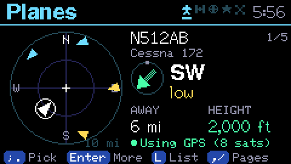

The round map is north up, with you at the `+` in the middle. Each plane is an arrow pointing the way
it's flying, coloured by its height: green under 3,000 feet, amber under 15,000 feet, and blue above
that. A drone that broadcasts ADS-B shows in pink, but few do. The chosen plane has a white ring, and
its card beside the map says which way to look, with an arrow pointing that way and how many fists up,
then how far away it is and how high. It starts on the nearest.

- **`;` and `.`** go to the next or the one before, and **Enter** opens it.
- **`-` and `=`** make the ring smaller or bigger: 5, 10, 25 or 50 miles (8, 15, 40 or 80 km). It starts
  at 5 miles each time.
- **L** lists every plane in the ring, nearest first, and **R** looks again now. **S** keeps the chosen
  plane in Spotted.

The map updates every 10 seconds.

### The list

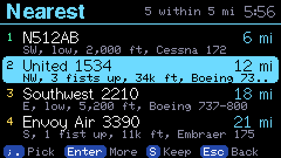

**L** on the sky map lists every plane in the ring, nearest first: its name and distance, then which
way, how high to look, its height and its type. `;` and `.` move, `,` and `/` move a screenful,
**Enter** opens one, **S** keeps it, and Esc goes back to the map.

### A plane

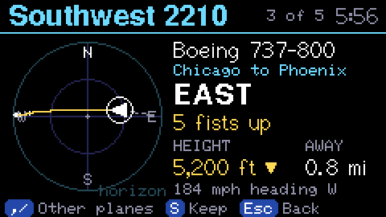

The round picture is **your sky**, drawn like the map, north up and east right: the ring is the
horizon all round you, and the middle is straight over your head. A plane right above you is in
the middle; one low in the north-east is near the ring at the top right; one halfway up is halfway
out. It's placed from where you are (the Cap's GPS, or the Weather city without a fix), the plane's
direction from you and how high it looks.

Its **path** is drawn across it, flying straight on: dashed where it came from over the last two
minutes, and bright for the next five, with a white dot each minute and an arrow where it ends or
goes below the horizon. So you can see which way it's going, and whether it's about to pass over.

Beside it: the plane's type and route (when the flight data has one; small planes usually don't),
which way to look in big letters, and how high in **fists**: hold your arm out straight with a fist,
put the bottom of your fist on the horizon, and stack fists on top, each about 10 degrees of sky.
Then its height, with a small arrow when it's climbing or coming down, how far away it is, and its
speed and heading.

`,` and `/` go to the other planes, **S** keeps it in Spotted, and Esc goes back to the map or the list.
If the plane flies out of the ring, its screen says so and keeps what it last knew.

### Look up!

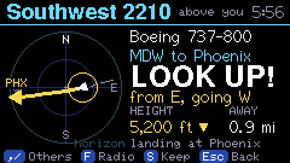

When a plane is high above you, more than about 50 degrees up, the Cardputer chimes and shows
**Look up!** with which way it's coming from and where it's going. Each plane does this once, and
at most one every 45 seconds. It comes up on the sky map and a plane's screen. While Skywatch is open,
the screen dims at the screensaver's time instead of going to the clock, so Look up! can still light it.
**Enter** opens the plane, **S** keeps it, and Esc goes back.

### The space station's next passes

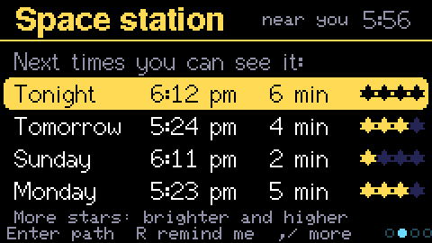

The station can only be seen when your sky is dark and the station, 260 miles up, is still in
sunlight. So passes come near dusk and dawn, and some weeks have none. The list shows the next ones
in the next 10 days: the day, the time it appears, how long you can see it, and up to four stars for
how bright it is. Four stars is brighter than any star in the sky. Passes under a minute long or low
in the sky are left out.

- **`;` and `.`** pick a pass, and **Enter** draws its path.
- **R** sets a reminder for it, and R again turns it off. A bell marks the pass with a reminder.

### A pass's path

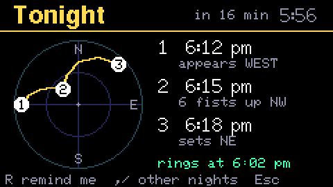

This is your sky drawn like the map, north up and east right: the ring is the horizon and the middle is
straight overhead. So
the closer the path comes to the middle, the higher you look. **1** is where it appears, **2** its
highest point (in fists) and **3** where it goes. "Sets" means it goes down to the horizon, and
"vanishes" means it flies into the Earth's shadow, still high up, which is fun to watch.

`,` and `/` go to the other passes, **R** sets or clears the reminder, and Esc goes back to the list.

### The reminder

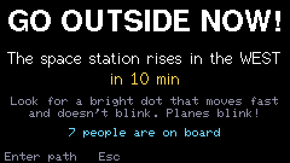

A reminder rings 10 minutes before the pass, from any screen, even if the Cardputer was restarted
in between. The radio or a podcast stops for it. The screen counts down and says which way to look.
The station looks like a bright star moving steadily across the sky, without blinking. Planes blink.
**Enter** draws the path. There's one reminder at a time, so setting another moves it.

### The space station right now

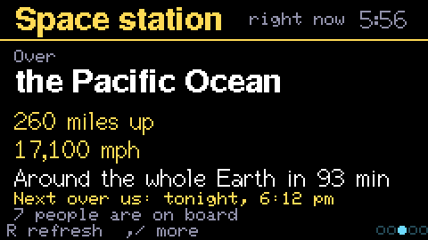

This page shows what the station is flying over, how high and how fast, how long it takes to go
round the Earth, when it next passes over you, and how many people are on board. It updates every
20 seconds, and **R** asks now.

### Spotted

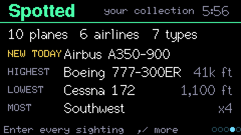

Every plane you keep with **S** goes into `/planes/spotted.txt` on the SD card, a line each: the
time, the plane's code, its name, its type and its height. Spotted counts them up: how many planes,
airlines and types, the type that's newest in the collection, the highest and lowest planes, and the
airline seen most. **Enter** lists the newest 40, and `;` and `.` scroll. A plane can be kept once
each time Skywatch is opened.

### Drones

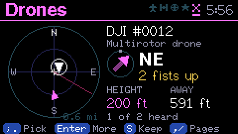

In the US nearly every drone has to broadcast **Remote ID** while it's on: who it is, where it is,
how high and how fast, and where it's flown from. The Cardputer can hear the ones that send it over
Wi-Fi, which DJI's drones do, from a few hundred feet away, sometimes more. Drones that send it only
over Bluetooth can't be heard yet.

The page doesn't listen until you press **Enter**, because while it listens the Cardputer's Wi-Fi
leaves your network to work as a receiver: the plane list, the chat and updates wait. It joins your
network again as soon as you leave the page. Listening needs no internet, so it works away from home
too.

- **The map** shows the drones heard as pink arrows, with the Cap's GPS fix, and the chosen one's card
  beside it says which way to look. Without a fix, the card shows its height and how strong its signal is.
- **`;` and `.`** go from drone to drone, strongest signal first, **Enter** opens one, and **S** keeps it.
- **A drone** says what kind it is, the pilot's own words if they gave any, its ID, which way to look
  and how many fists up, its height, distance and speed, and how far it is from where it's flown from.
- **Drone nearby!** comes with a chime the first time each drone is heard while the page is open.

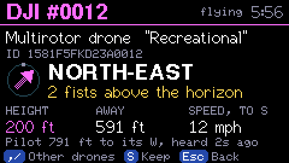

What a drone says about itself is what you see: the Cardputer can't check it.

## How it works

The Cardputer asks the bridge every 10 seconds while the sky map or a plane is on screen (every 30
away from home, where each ask is a heavier HTTPS one), and for the station when its pages are. At home it goes over the bridge's plain-HTTP door on your Wi-Fi, as
Podcasts and Cameras do, and away from home over HTTPS. The bridge
(`bridge/src/planes.mjs`) answers in short lines of text:

- **Planes** come from [adsb.lol](https://adsb.lol), a free community flight tracker. Names, routes and
  airlines come from [adsbdb](https://www.adsbdb.com), and the ground's height for "how high to look"
  from [Open-Meteo](https://open-meteo.com). Planes on the ground are left out.
- **The station's orbit** comes from [CelesTrak](https://celestrak.org), at most every six hours, and
  the bridge works out the passes with [satellite.js](https://github.com/shashwatak/satellite-js),
  including where the Sun is and when the station is in the Earth's shadow.
- **What the station is over** comes from [OpenStreetMap's Nominatim](https://nominatim.org) for land,
  and the bridge names the ocean or sea itself. **Who's on board** comes from a crew list kept on
  [GitHub](https://github.com/corquaid/international-space-station-APIs).

The bridge needs satellite.js, so after updating, run `npm install` in `bridge/` before restarting it.

**Drones** don't go through the bridge. While the page listens, the Wi-Fi radio stays off any network
in a listening mode, mostly on channel 6, where drones send Remote ID by Wi-Fi Aware, and visits the
other channels in turn for drones that send it in beacons, staying longer where one was heard.
`drone_id.h` reads the ASTM F3411 messages, following the layouts in the Open Drone ID reference code
(opendroneid-core-c).

## If something goes wrong

- **"The bridge needs an update for Skywatch":** the bridge is older than this firmware. Update it, run
  `npm install` in `bridge/`, and restart it.
- **"Can't find" your town:** change the Weather city in Settings, Device. "Salem, MA" style, a town and
  a state, works best.
- **No passes:** there may be none you can see this week. Try again in a few days.
- **A route that looks wrong:** the routes come from a shared database and are sometimes out of date.
- **No drones heard:** a drone has to be on and close, and send Remote ID over Wi-Fi. Some send it only
  over Bluetooth, which the Cardputer doesn't listen to yet.
