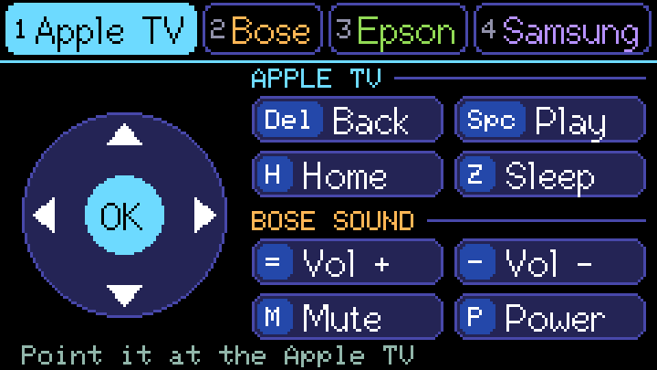
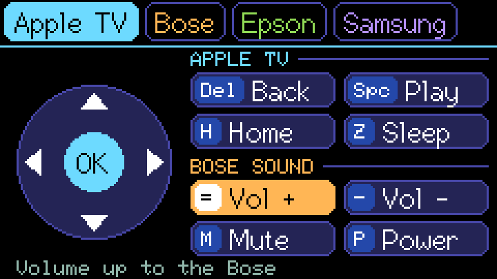
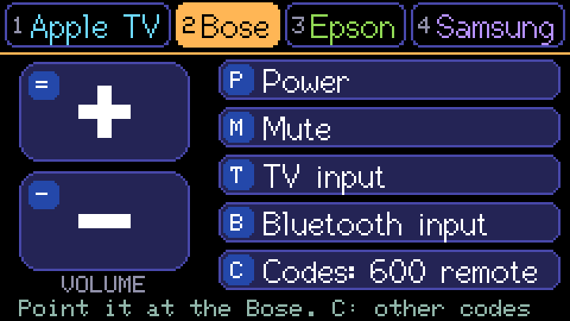
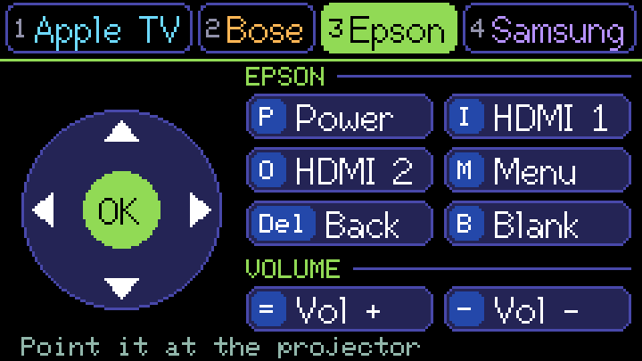
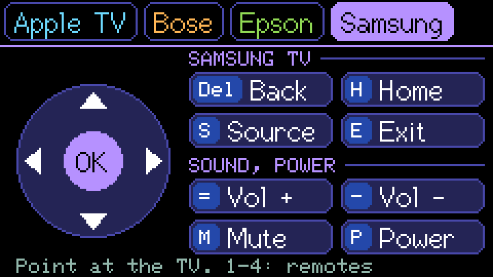
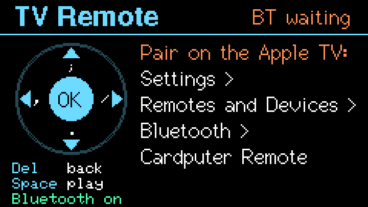
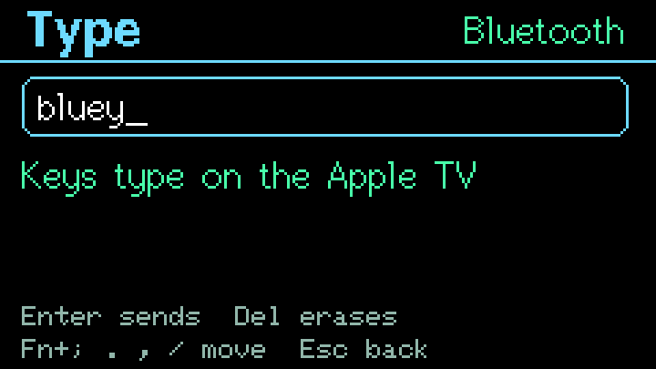

# TV Remote

> **Bluetooth is out of the firmware for now (0.2.309).** Having it in the image at all left every
> app about 17.5 KB less memory, and on 0.2.307 that broke HTTPS: the chip's hash unit couldn't get
> a buffer while checking the bridge's certificate, so chat, updates and everything else on the
> network failed. Infrared works as described here. The Bluetooth and typing parts below are how it
> works once it's back, which needs that memory found elsewhere first. Until then B and T say
> "Bluetooth isn't in this version".

Tab, T, TV Remote, or type `/tv`. It's a remote for four devices, a page each: an **Apple
TV**, a **Bose** soundbar, an **Epson** projector and a **Samsung** TV. Press **1** to **4** to
change page; it opens on the page you used last. Everything goes by infrared, so point the
Cardputer at the device, as you would its own remote.

Each button shows the key that presses it, and lights up for a moment as its code goes out:

Each device has its colour, on its tab and on its buttons. The bottom line says what the last key
sent and to what, such as "Up to the Apple TV" or "Volume up to the Bose". Holding an arrow or a
volume key keeps it going. Esc leaves the app.

The screen dims and goes off on the usual timers, but the screensaver doesn't start here, and a
key pressed with the screen dimmed or off still does its job, as on a real remote.

## 1 Apple TV

| Key | What it does |
|---|---|
| `;` `.` `,` `/` | Up, down, left and right, with or without Fn |
| Enter | OK |
| Del | Back, the Siri Remote's Back or Menu button |
| Space | Play or pause |
| H | Home, the Siri Remote's TV button |
| Z | Sleep. With HDMI-CEC on, what's plugged into it goes off too |
| `=` `-` M P | **The Bose's** volume up and down, mute and power, for when the Apple TV's sound goes through a Bose soundbar |

The Apple TV's codes are its own Siri Remote's, recorded from an Apple TV 4K. Home and the arrows
are known to work from the Cardputer.

## 2 Bose

| Key | What it does |
|---|---|
| `=` `-` | Volume up and down |
| M | Mute |
| P | Power |
| T | The TV input, the sound from HDMI |
| B | The Bluetooth input |
| C | The other code set |

Bose's soundbar remotes don't all send the same signal. There are recordings of two, the Smart
Soundbar 600's and the Soundbar 300's, and other Bose soundbars may answer either one. The page
starts with the 600's. If the Bose doesn't answer, press **C** for the 300's, and try again. The page shows which
is in use, and it's kept for next time.

## 3 Epson

| Key | What it does |
|---|---|
| P | Power. To turn it off, press P again when the projector asks |
| I | HDMI 1 |
| O | HDMI 2 |
| S | Source: the projector looks for a picture |
| M | Menu |
| `;` `.` `,` `/`, Enter, Del | Move in its menus, OK and Back |
| B | Blank: the picture and sound off and on, the projector still running |

Epson projectors share one set of codes. These are from the remote of an Epson EH-TW5650, a home
cinema projector, and three other Epson remotes agree, but not every model has every key, so one
may do nothing on yours. The projector has no volume of its own here: the
Apple TV page's volume keys work the Bose.

## 4 Samsung

| Key | What it does |
|---|---|
| `;` `.` `,` `/` | Up, down, left and right, with or without Fn |
| Enter | OK |
| Del | Return, back a step |
| H | Home, the Smart Hub |
| S | Source, to choose an input |
| E | Exit, out of an app or menu |
| `=` `-` | Volume up and down |
| M | Mute |
| P | Power |

The volume, mute and power are the codes Samsung TVs have used for years; the rest are as three
Samsung remotes' recordings have them alike.

## Bluetooth

Press **B**. The first time, the screen says where to pair it:

1. On the Apple TV, open **Settings**, then **Remotes and Devices**, then **Bluetooth**.
2. Pick **Cardputer Remote** from the list. No code is needed.
3. A green dot on the Apple TV tab says it's connected. From now on the arrows, OK, Back and Play go by Bluetooth.

After that the Apple TV connects again by itself, a few seconds after the app opens. Bluetooth
runs only while TV Remote is open. Leaving the app turns it off. If you left it on, it comes back
on the next time you open TV Remote. B turns it off for good, and the keys go by infrared again.

**Wi-Fi is off while Bluetooth is on.** Bluetooth needs the memory Wi-Fi uses, and the remote
doesn't need the network. Wi-Fi comes back by itself when you leave the app or press B, and
messages and updates catch up then. If something is still using the network when you press B,
Bluetooth starts as soon as it's done.

Home and Sleep always go by infrared, as do the other devices' keys, because a keyboard has no key
the Apple TV reads as those.

### Forgetting the Apple TV

Press **Shift+B**, then Shift+B again within four seconds. The Cardputer forgets every device it
was paired with. Forget it on the Apple TV as well (Settings, Remotes and Devices, Bluetooth,
Cardputer Remote, Forget Device) before pairing again.

## Typing

Press **T** wherever the Apple TV wants text: a search box, a sign-in, a Wi-Fi password. If
Bluetooth is off, T turns it on first.

Every key types on the Apple TV, the letters that are remote keys elsewhere too, with Shift for
capitals and symbols. Enter sends, Del erases, and **Fn** with `;` `.` `,` `/` moves, so you can
reach the next field or the Apple TV's own on-screen keys. Esc goes back to the remote.

The Cardputer shows what you've typed since the last Enter. It's never logged or saved, so a
password typed here stays on the screen only. The characters are those of a US keyboard, and a
letter with an accent can't be sent.

## Memory

Bluetooth takes memory that the radio and every secure connection also need, so:

- Opening TV Remote stops the radio or a podcast.
- Background checks for messages and updates wait until you leave, as on IR Remote.
- Turning Bluetooth on turns Wi-Fi off and clears the device's caches, to give it room.
- If there still isn't enough memory, the bottom line says why, Wi-Fi comes straight back, and
  infrared still works. The log's `TV` lines say how much
  there was and how much Bluetooth took.

Having Bluetooth in the firmware at all leaves every app about 17 KB less memory, even with
Bluetooth off. Most of that is the Bluetooth controller's code, which has to sit in the chip's
fast memory.

## Not tested on hardware yet

Checked on a computer, not yet with the devices:

- Which Bose code set a given Bose soundbar answers, if either.
- Which of the Epson keys a given Epson projector answers. Power, HDMI 1 and HDMI 2 are the likeliest.
- The Samsung's arrows, OK, Return, Home, Source and Exit. Its volume, mute and power work.
- Pairing with no code, reconnecting by itself, and which keys the Apple TV takes from a keyboard.
  Esc for Back and a media key for Play/Pause are my best reading, not something seen working.
- How much memory Bluetooth takes while it's on, and whether it starts again cleanly after
  leaving. The device's log says both: look for the `TV` lines in Logs, and press U there to send
  them to the bridge. 0.2.307 started Bluetooth with Wi-Fi on and had too little left, which is
  why 0.2.308 turns Wi-Fi off first.
